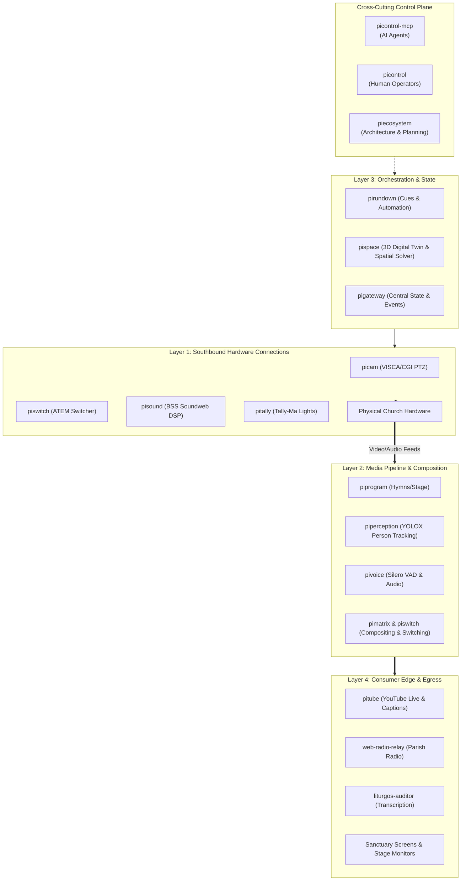

# Pi Ecosystem (`piecosystem`)

Welcome to the central coordination, architecture, and planning repository for the **Raspberry Pi Production Ecosystem** (`pi*`), the modular AV broadcast and live church service stack powering **Riihimäen Keskuskirkko**.

---

## 1. Ecosystem Overview

The Pi Ecosystem is a decoupled suite of lightweight microservices, drivers, control planes, and media engines deployed on Raspberry Pi hardware and church workstations. It powers automated video switching, PTZ camera tracking, acoustic voice detection, live liturgical slide projection, tally indicators, and synchronized YouTube broadcasting with live captions.



---

## 2. The Layering Model: Proposed vs. Refined Architecture

### Evaluation of the 4-Layer Concept
The user-proposed 4-layer taxonomy:
1. **Hardware connections**
2. **Media creation**
3. **Event orchestration**
4. **Consumer edge**

This model is intuitive and accurately describes the linear journey of media. However, in professional broadcast systems, two critical engineering boundaries must be enforced:
1. **Control Plane vs. Data Plane Separation**: High-throughput media (video/audio frames) must never traverse HTTP control gateways (`pigateway` and `pivoice` strictly follow this invariant).
2. **Creation vs. Real-Time Processing**: Content authoring (Canva slides, hymns) is decoupled from real-time video compositing and matrix routing (`pimatrix`).
3. **Cross-Cutting Control Plane**: Operator UIs (`picontrol`) and AI agent interfaces (`picontrol-mcp`) span across all layers.

### Refined "4+1 Plane Broadcast Architecture"

| Plane / Layer | Key Responsibility | Active Projects |
|---|---|---|
| **Layer 1: Southbound Hardware Interfacing** | Physical device protocol drivers (VISCA, HiQnet, ATEM, Tally-Ma, ALSA), video matrix crossbars & hardware display sinks. | [`pimatrix`](file:///d:/pimatrix), [`picam`](file:///d:/picam), [`piswitch`](file:///d:/piswitch), [`pisound`](file:///d:/pisound), [`pitally`](file:///d:/pitally), [`pivoice`](file:///d:/pivoice), [`pigateway`](file:///d:/pigateway), [`pipoe`](file:///d:/pipoe) |
| **Layer 2: Media Pipeline & Real-Time Composition** | Content authoring, slide staging, graphics generation, Speech-to-Text transcription, audio VAD/DSP, video perception, and compositing. | [`piprogram`](file:///d:/piprogram), [`pigraphics`](file:///d:/pigraphics), [`liturgos-auditor`](file:///d:/liturgos-auditor), [`piperception`](file:///d:/piperception), [`pivoice`](file:///d:/pivoice) |
| **Layer 3: Orchestration, State & Workflow** | Deterministic service rundowns, YAML v2 cue sheets, dynamic variable fetching, 3D venue digital twins, and centralized SSE event distribution. | [`pirundown`](file:///d:/pirundown), [`pispace`](file:///d:/pispace), [`pigateway`](file:///d:/pigateway) |
| **Layer 4: Presentation & Egress Delivery (Consumer Edge)** | External broadcasting (YouTube Live), timed closed caption streaming, low-latency web radio, sanctuary projectors, and confidence monitors. | [`pitube`](file:///d:/pitube), [`web-radio-relay`](file:///d:/web-radio-relay), [`liturgos-auditor`](file:///d:/liturgos-auditor), [`pimatrix`](file:///d:/pimatrix) (HDMI), [`piprogram`](file:///d:/piprogram) (Stage) |
| **+1 Cross-Cutting Control & Agentic Plane** | Unified human operator UI/CLI, Model Context Protocol (MCP) tooling for AI agents (`pi://` resources), and ecosystem governance. | [`picontrol`](file:///d:/picontrol), [`picontrol-mcp`](file:///d:/picontrol-mcp), [`piecosystem`](file:///d:/piecosystem) |

### Seam projects

A **seam** project is not a `pi*` service and not part of the Pi layers. It runs off the Pi (operator PC, VPS, compute fleet) or is a control program for a device, and it meets the Pi ecosystem at a defined interface (RTMP, HTTP, WebSocket, a TCP protocol). Seam projects are listed apart from the layers above and carry `layer: Seam` in the catalog.

| Seam project | Where it runs | Meets the Pi ecosystem at |
|---|---|---|
| `virtual-screen-streamer` (formerly `picompanion`) | Operator PC (Windows) | RTMP into `pimatrix` / MediaMTX |
| `liturgos-auditor` | Operator PC / GPU host | Speech-to-text API used by `pigateway` and `pitube` |
| `web-radio-relay` | Church VPS | Radio stream from `pivoice` over the reverse-ssh tunnel |
| `fffleet` | Orchestrator and workers | Job API for renders and transcodes |
| `keskuskirkko` | AMX NX master | TCP protocol with `pimatrix` / `pigateway` |
| `canva-pieco-app` (formerly `picanva`) | Canva (browser iframe) | HTTPS `/api/v1/canva/*` routes on `pigateway` |
| `saarnavideo` | Server / operator PC | Post-stream editing: takes finished recordings and publishes videos |

`live-captions-yt` (LCYT) is a **reference** for features and behaviour, not a seam project and not part of the Pi layers.

👉 **Read the full architectural evaluation**: [docs/architecture-layers.md](docs/architecture-layers.md)

---

## 3. Project Inventory

| Project | Role & Description | Tech Stack | Port(s) |
|---|---|---|---|
| [`picam`](file:///d:/picam) | VISCA-over-IP & CGI PTZ camera controller & preset manager | Node 24, Fastify, TS | `3102`, VISCA `52381` |
| [`canva-pieco-app`](file:///d:/canva-pieco-app) (seam) | Canva App plugin for liturgical slides & presentation control (formerly `picanva`; runs inside Canva, not a Pi service) | TS, Canva SDK, React | Canva Sandbox |
| [`virtual-screen-streamer`](file:///d:/virtual-screen-streamer) (seam) | Windows virtual monitor driver & RTMP desktop sender (runs on the operator PC, not a Pi service; formerly `picompanion`) | C#, .NET, IddCx | RTMP Out |
| [`picontrol`](file:///d:/picontrol) | Operator UI console & unified CLI housing | React, Vite, Node 22+ | `5173` (dev) |
| [`picontrol-mcp`](file:///d:/picontrol-mcp) | MCP Server exposing `pi://` resources to AI agents | Node 24, Fastify, TS | `3600` |
| [`pigateway`](file:///d:/pigateway) | Central device broker, AMX NetLinx driver & SSE event bus | Node 24, Fastify, TS | `3000` (UDP: `3101`, `3102`) |
| [`pigraphics`](file:///d:/pigraphics) | Broadcast graphics engine, CSS animations & Fill/Key streaming | Node 22+, Fastify, TS | `3201` |
| [`pitally`](file:///d:/pitally) | Wireless multi-segment tally light controller (Tally-Ma) | Node 22+, Fastify, TS | `3107`, UDP `21324` |
| [`pipoe`](file:///d:/pipoe) | PoE switch controller: port status, PoE on/off/cycle (PLANET GS-4210-16P2S, SNMP) | Node 22+, Fastify, TS | `3108`, SNMP `161` |
| [`pimatrix`](file:///d:/pimatrix) | Video routing, software compositing & display output plane | Node 24, GStreamer, C++ | `8080`, `8081` |
| [`piprogram`](file:///d:/piprogram) | Hymns, slides, PPTX pipeline & stage confidence monitor | Node 24, Fastify, TS | Fastify Configurable |
| [`pirundown`](file:///d:/pirundown) | Service rundown cue engine (Rundown v2 YAML, varfetch) | Node 22+, Fastify, TS | `3400` |
| [`pisound`](file:///d:/pisound) | Sound & microphone controller for BSS Soundweb BLU-100 | Node 22+, Fastify, TS | `3105`, Soundweb `1023` |
| [`pispace`](file:///d:/pispace) | 3D venue digital twin, FreeD raycasting & spatial PTZ solver | Node 22+, Fastify, TS | `3203` |
| [`piswitch`](file:///d:/piswitch) | Universal video mixer service (ATEM & software switcher) | Node 22+, Fastify, TS | `3103`, ATEM UDP `9910` |
| [`pitube`](file:///d:/pitube) | YouTube Live lifecycle manager & timed live caption sender | Node 22+, TS | `3500` |
| [`pivoice`](file:///d:/pivoice) | ALSA mic capture, Silero VAD neural analysis & PCM fanout | Node 24, ONNX Runtime | REST API & UDP `3106` |
| [`piperception`](file:///d:/piperception) | Real-time YOLOX/ONNX person detection & multi-target tracking | Node 22+, Fastify, TS | `3202` |
| [`piecosystem`](file:///d:/piecosystem) | Ecosystem governance, architecture docs & dev coordination | Node, Markdown | N/A |

👉 **Complete details on each project**: [docs/projects-catalog.md](docs/projects-catalog.md)

---

## 4. Documentation Index

- 📐 **[Architectural Layers & Evaluation](docs/architecture-layers.md)**: Deep dive into the 4+1 plane model, Control vs Data plane invariants, and comparison with the proposed 4-layer taxonomy.
- 📦 **[Projects Catalog](docs/projects-catalog.md)**: In-depth technical specifications, runtime environments, and capabilities for all 15 repositories.
- 🔌 **[Inter-Service Communication & Ports Matrix](docs/inter-service-matrix.md)**: Protocol specifications, network listening port table, and security boundaries.
- 🎬 **[End-to-End Workflow Scenarios](docs/workflow-scenarios.md)**: Step-by-step sequence diagrams for Sunday worship cue execution, AI agent assistance, and live captioning.
- 🛠️ **[Developer Coordination & Conventions](docs/dev-coordination.md)**: Multi-repo maintenance guidelines, shared Fastify/TypeScript rules, OpenAPI contracts, and status tooling.

---

## 5. Multi-Repository Management

To quickly check the status of all repositories across the ecosystem:

```bash
# In D:\piecosystem
npm run status
```

Output preview:
```text
======================================================
           PI ECOSYSTEM REPOSITORY STATUS             
======================================================

┌─────────┬─────────────────┬─────────┬──────────┬────────┐
│ (index) │ Project         │ Version │ Branch   │ Status │
├─────────┼─────────────────┼─────────┼──────────┼────────┤
│ 0       │ 'picam'         │ '0.1.0' │ 'main'   │ 'Clean'│
│ 1       │ 'canva-pieco-app' │ '1.0.0' │ 'main'   │ 'Clean'│
│ ...     │ ...             │ ...     │ ...      │ ...    │
│ 14      │ 'piecosystem'   │ '1.0.0' │ 'main'   │ 'Clean'│
└─────────┴─────────────────┴─────────┴──────────┴────────┘
```

---

## 6. Ecosystem Catalog and Health Check

`ecosystem.yaml` is the generated catalog of running services: name, port, health endpoint, version, dependencies, git origin. It is built from two inputs and is **not committed** (it records the local git origins of one machine). Node 22+ and pnpm 11 (`packageManager` pins it) are required.

```bash
pnpm install
pnpm sync                          # write ecosystem.yaml
pnpm sync --check               # exit 1 if ecosystem.yaml is stale (run where the sibling repos exist)
pnpm health                        # probe every service once (table)
pnpm health --json              # the same as JSON
pnpm health --fail-on-unhealthy # exit 1 when a service is DEGRADED or OFFLINE
pnpm deps                          # shared dependencies across the pi* repos: declared vs locked, with mismatches
pnpm deps --installed --root /home/pi/apps   # on the Pi: also compare node_modules
pnpm deps --json                   # the same as JSON (`--all`, `--package <name>`, `--npm-root <dir>`, `--fail-on-mismatch`)
pnpm test
```

Inputs:

- **The `pi` block** in a sibling repository's `package.json` (the repository declares itself).
- **`ecosystem.manual.yaml`** in this repository, for services that cannot carry a `pi` block: Python services, a directory without `package.json`, or a non-HTTP system. It has the same keys as the `pi` block plus `dir` (default: the service name), `runtime` (`node`, `python`, `other`) and `versionFile` (a `package.json` or `pyproject.toml` inside `dir` that supplies the version).

Both are read from the ecosystem root: `PI_ROOT`, or the parent directory of this repository.

### The pi block

```json
{
  "pi": {
    "service": "picam",
    "displayName": "picam",
    "layer": "Layer 1: Southbound HW",
    "kind": "service",
    "port": 3300,
    "ports": { "visca": 52381 },
    "healthEndpoint": "/health",
    "envPortVar": "PICAM_PORT",
    "healthAuthEnv": "PICAM_API_KEY",
    "hostOverride": "kirkonpi.local"
  }
}
```

| Key | Required | Meaning |
|---|---|---|
| `service` | yes | Lowercase name, unique across the ecosystem. |
| `displayName` | no | Human name (default: `service`). |
| `layer` | no | Free text, e.g. the layer of the architecture. |
| `kind` | no | `service` (default), `library` or `control`. A library or a service without a port is reported STATIC. |
| `port` | with `healthEndpoint` | HTTP port, integer 1 to 65535. Duplicates fail the sync (see below). |
| `ports` | no | Other named ports, e.g. `{ "visca": 52381 }`. Not checked for duplicates, not probed. |
| `healthEndpoint` | with `port` | Path starting with `/`, probed with GET. |
| `envPortVar` | no | Environment variable the service reads for its port. When that variable is set where the check runs, its value replaces `port`. |
| `healthAuthEnv` | no | Environment variable holding an API key. When set, it is sent in the `X-Api-Key` header. |
| `hostOverride` | no | Host the service runs on when it is not the probed host (`PI_HOST`). Also separates ports: two services may share a port when their `hostOverride` values differ. |

Unknown keys are errors, so a misspelt key cannot silently disappear. A `pi` block and a manual entry for the same service: the `pi` block wins and the sync prints a warning (delete the manual entry). Two `pi` blocks with the same service name are an error.

### What the sync checks and writes

- **Duplicate HTTP ports fail the sync** and list the services that share the port. Fix the port, set `hostOverride` when the services run on different hosts, or pass `--allow-duplicates` to accept the duplicates with a warning.
- The output has **no timestamp**: the file changes only when an input changes. `--check` compares content (CRLF line endings are ignored).
- Each service records its git origin (credentials removed), version, `packageManager`, `engines`, and the versions of `fastify`, `typescript`, `tsx` and `zod` when they are declared.

### Health states

| State | Meaning |
|---|---|
| `ONLINE` | GET answered 2xx. |
| `DEGRADED` | GET answered with another status, redirects included (not followed). |
| `OFFLINE` | No answer within 1500 ms, or the connection failed (`ECONNREFUSED` etc.). |
| `STATIC` | No `port` or no `healthEndpoint`: not probed. |

The health check also prints each repository's git branch, the number of dirty files, and whether it uses pnpm (`pnpm-lock.yaml`), npm (`package-lock.json`), both or neither. The only network traffic is one GET per service; nothing is written.

Tests: `test/generate-ecosystem.test.mjs` (fixture workspaces, duplicates, stale check, credential stripping) and `test/ecosystem-health.test.mjs` (a local HTTP server for each state). Neither touches a real service or a real sibling repository.
