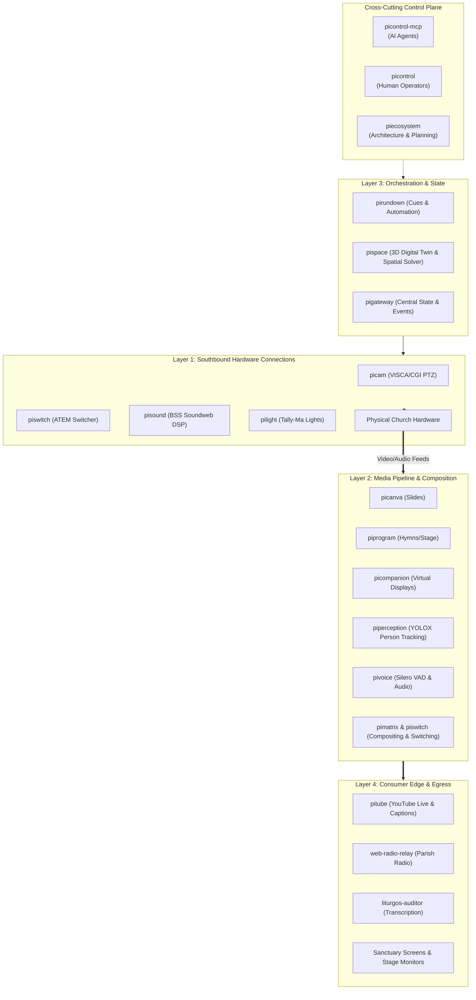

# Pi Ecosystem (`piecosystem`)

Welcome to the central coordination, architecture, and planning repository for the **Raspberry Pi Production Ecosystem** (`pi*`), the modular AV broadcast and live church service stack powering **Riihimäen Keskuskirkko**.

---

## 1. Ecosystem Overview

The Pi Ecosystem is a decoupled suite of lightweight microservices, drivers, control planes, and media engines deployed on Raspberry Pi hardware and church workstations. It powers automated video switching, PTZ camera tracking, acoustic voice detection, live liturgical slide projection, tally indicators, and synchronized YouTube broadcasting with live captions.



---

## 2. The Layering Model: Proposed vs. Refined Architecture

### Evaluation of the 4-Layer Concept
The user-proposed 4-layer taxonomy:
1. **Hardware connections**
2. **Media creation**
3. **Event orchestration**
4. **Consumer edge**

This model is intuitive and accurately describes the linear journey of media. However, in professional broadcast systems, two critical engineering boundaries must be enforced:
1. **Control Plane vs. Data Plane Separation**: High-throughput media (video/audio frames) must never traverse HTTP control gateways (`pigateway` and `pivoice` strictly follow this invariant).
2. **Creation vs. Real-Time Processing**: Content authoring (Canva slides, hymns) is decoupled from real-time video compositing and matrix routing (`pimatrix`).
3. **Cross-Cutting Control Plane**: Operator UIs (`picontrol`) and AI agent interfaces (`picontrol-mcp`) span across all layers.

### Refined "4+1 Plane Broadcast Architecture"

| Plane / Layer | Key Responsibility | Active Projects |
|---|---|---|
| **Layer 1: Southbound Hardware Interfacing** | Physical device protocol drivers (VISCA, HiQnet, ATEM, Tally-Ma, ALSA), video matrix crossbars & hardware display sinks. | [`pimatrix`](file:///d:/pimatrix), [`picam`](file:///d:/picam), [`piswitch`](file:///d:/piswitch), [`pisound`](file:///d:/pisound), [`pilight`](file:///d:/pilight), [`pivoice`](file:///d:/pivoice), [`pigateway`](file:///d:/pigateway), [`pipoe`](file:///d:/pipoe) |
| **Layer 2: Media Pipeline & Real-Time Composition** | Content authoring, slide staging, graphics generation, Speech-to-Text transcription, audio VAD/DSP, video perception, and compositing. | [`picanva`](file:///d:/picanva), [`piprogram`](file:///d:/piprogram), [`pigraphics`](file:///d:/pigraphics), [`picompanion`](file:///d:/picompanion), [`liturgos-auditor`](file:///d:/liturgos-auditor), [`piperception`](file:///d:/piperception), [`pivoice`](file:///d:/pivoice) |
| **Layer 3: Orchestration, State & Workflow** | Deterministic service rundowns, YAML v2 cue sheets, dynamic variable fetching, 3D venue digital twins, and centralized SSE event distribution. | [`pirundown`](file:///d:/pirundown), [`pispace`](file:///d:/pispace), [`pigateway`](file:///d:/pigateway) |
| **Layer 4: Presentation & Egress Delivery (Consumer Edge)** | External broadcasting (YouTube Live), timed closed caption streaming, low-latency web radio, sanctuary projectors, and confidence monitors. | [`pitube`](file:///d:/pitube), [`web-radio-relay`](file:///d:/web-radio-relay), [`liturgos-auditor`](file:///d:/liturgos-auditor), [`pimatrix`](file:///d:/pimatrix) (HDMI), [`piprogram`](file:///d:/piprogram) (Stage) |
| **+1 Cross-Cutting Control & Agentic Plane** | Unified human operator UI/CLI, Model Context Protocol (MCP) tooling for AI agents (`pi://` resources), and ecosystem governance. | [`picontrol`](file:///d:/picontrol), [`picontrol-mcp`](file:///d:/picontrol-mcp), [`piecosystem`](file:///d:/piecosystem) |

👉 **Read the full architectural evaluation**: [docs/architecture-layers.md](docs/architecture-layers.md)

---

## 3. Project Inventory

| Project | Role & Description | Tech Stack | Port(s) |
|---|---|---|---|
| [`picam`](file:///d:/picam) | VISCA-over-IP & CGI PTZ camera controller & preset manager | Node 24, Fastify, TS | `3300`, VISCA `52381` |
| [`picanva`](file:///d:/picanva) | Canva App plugin for liturgical slides & presentation control | TS, Canva SDK, React | Canva Sandbox |
| [`picompanion`](file:///d:/picompanion) | Windows virtual monitor driver & RTMP desktop sender | C#, .NET, IddCx | RTMP Out |
| [`picontrol`](file:///d:/picontrol) | Operator UI console & unified CLI housing | React, Vite, Node 22+ | `3000` (Dev: `5173`) |
| [`picontrol-mcp`](file:///d:/picontrol-mcp) | MCP Server exposing `pi://` resources to AI agents | Node 24, Fastify, TS | `3200` |
| [`pigateway`](file:///d:/pigateway) | Central device broker, AMX NetLinx driver & SSE event bus | Node 24, Fastify, TS | `3100` (UDP: `3101`, `3102`) |
| [`pigraphics`](file:///d:/pigraphics) | Broadcast graphics engine, CSS animations & Fill/Key streaming | Node 22+, Fastify, TS | `3107` |
| [`pilight`](file:///d:/pilight) | Wireless multi-segment tally light controller (Tally-Ma) | Node 22+, Fastify, TS | `3200`/`3201`, UDP `21324` |
| [`pipoe`](file:///d:/pipoe) | PoE switch controller: port status, PoE on/off/cycle (PLANET GS-4210-16P2S, SNMP) | Node 22+, Fastify, TS | `3302`, SNMP `161` |
| [`pimatrix`](file:///d:/pimatrix) | Video routing, software compositing & display output plane | Node 24, GStreamer, C++ | `8080`, `8081` |
| [`piprogram`](file:///d:/piprogram) | Hymns, slides, PPTX pipeline & stage confidence monitor | Node 24, Fastify, TS | Fastify Configurable |
| [`pirundown`](file:///d:/pirundown) | Service rundown cue engine (Rundown v2 YAML, varfetch) | Node 22+, Fastify, TS | `3400` |
| [`pisound`](file:///d:/pisound) | Sound & microphone controller for BSS Soundweb BLU-100 | Node 22+, Fastify, TS | `3300`, Soundweb `1023` |
| [`pispace`](file:///d:/pispace) | 3D venue digital twin, FreeD raycasting & spatial PTZ solver | Node 22+, Fastify, TS | `3108` |
| [`piswitch`](file:///d:/piswitch) | Universal video mixer service (ATEM & software switcher) | Node 22+, Fastify, TS | `3106`, ATEM UDP `9910` |
| [`pitube`](file:///d:/pitube) | YouTube Live lifecycle manager & timed live caption sender | Node 22+, TS | `3105` |
| [`pivoice`](file:///d:/pivoice) | ALSA mic capture, Silero VAD neural analysis & PCM fanout | Node 24, ONNX Runtime | REST API & UDP `3101` |
| [`piperception`](file:///d:/piperception) | Real-time YOLOX/ONNX person detection & multi-target tracking | Node 22+, Fastify, TS | `3110` |
| [`piecosystem`](file:///d:/piecosystem) | Ecosystem governance, architecture docs & dev coordination | Node, Markdown | N/A |

👉 **Complete details on each project**: [docs/projects-catalog.md](docs/projects-catalog.md)

---

## 4. Documentation Index

- 📐 **[Architectural Layers & Evaluation](docs/architecture-layers.md)**: Deep dive into the 4+1 plane model, Control vs Data plane invariants, and comparison with the proposed 4-layer taxonomy.
- 📦 **[Projects Catalog](docs/projects-catalog.md)**: In-depth technical specifications, runtime environments, and capabilities for all 15 repositories.
- 🔌 **[Inter-Service Communication & Ports Matrix](docs/inter-service-matrix.md)**: Protocol specifications, network listening port table, and security boundaries.
- 🎬 **[End-to-End Workflow Scenarios](docs/workflow-scenarios.md)**: Step-by-step sequence diagrams for Sunday worship cue execution, AI agent assistance, and live captioning.
- 🛠️ **[Developer Coordination & Conventions](docs/dev-coordination.md)**: Multi-repo maintenance guidelines, shared Fastify/TypeScript rules, OpenAPI contracts, and status tooling.

---

## 5. Multi-Repository Management

To quickly check the status of all repositories across the ecosystem:

```bash
# In D:\piecosystem
npm run status
```

Output preview:
```text
======================================================
           PI ECOSYSTEM REPOSITORY STATUS             
======================================================

┌─────────┬─────────────────┬─────────┬──────────┬────────┐
│ (index) │ Project         │ Version │ Branch   │ Status │
├─────────┼─────────────────┼─────────┼──────────┼────────┤
│ 0       │ 'picam'         │ '0.1.0' │ 'main'   │ 'Clean'│
│ 1       │ 'picanva'       │ '1.0.0' │ 'main'   │ 'Clean'│
│ ...     │ ...             │ ...     │ ...      │ ...    │
│ 14      │ 'piecosystem'   │ '1.0.0' │ 'main'   │ 'Clean'│
└─────────┴─────────────────┴─────────┴──────────┴────────┘
```
