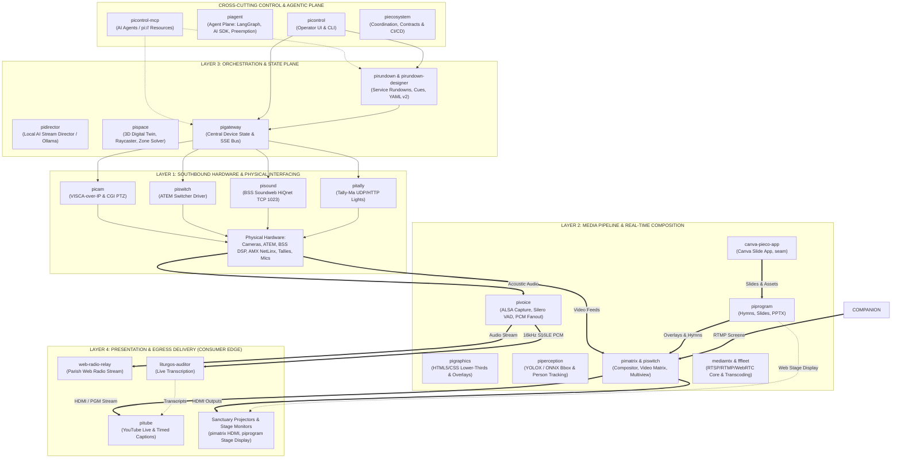

# Architecture & Layering Model

This document defines the architectural layers of the **Pi Production Ecosystem** (`pi*`), a modular, edge-native AV broadcast and live production stack powering worship services and events at the venue.

---

## 1. Evaluation of the Proposed 4-Layer Model

The proposed layer taxonomy provides a clean, intuitive mental model:
1. **Hardware connections**
2. **Media creation**
3. **Event orchestration**
4. **Consumer edge**

### Strengths of the Model
- **Linear & Comprehensible**: It traces the journey of media and signals from physical stage/sanctuary equipment, through creation and orchestration, out to the end consumer.
- **Clear Operational Scope**: Distinguishes between physical device control, content generation, event sequencing, and external distribution.

### Critical Broadcast Architecture Refinements
In production broadcast and AV-over-IP systems, standard practice requires addressing three core nuances:

1. **Strict Separation of Control Plane vs. Media (Data) Plane**:
   - High-bandwidth media streams (HDMI video, 1080p60 RTSP, multi-channel PCM audio, RTMP) **must never traverse control APIs or gateways**.
   - As mandated across `pigateway` and `pivoice`, control signals (e.g., VISCA UDP packets, ATEM program cuts, HiQnet volume levels) are lightweight, asynchronous, and deterministic, while audio/video frames travel directly between dedicated media pipelines.
   - If "Hardware connections" conflates device control (VISCA, Tally UDP) with raw video/audio capture (HDMI, USB ALSA), architectural boundaries blur.

2. **"Media Creation" vs. "Real-Time Media Processing & Composition"**:
   - *Media Creation & Staging*: Designing slides in Canva (`canva-pieco-app`), formatting service hymns (`piprogram`), or generating virtual monitors on the operator PC (`virtual-screen-streamer`, a seam project outside the Pi layers).
   - *Live Media Processing & Matrixing*: Compositing video layers, switching camera feeds, PiP overlays, and hardware display outputs (`pimatrix`, `piswitch`).

3. **Defining the "Consumer Edge"**:
   - In IoT and edge computing, the Raspberry Pi itself is an edge node.
   - In broadcast architecture, the "Consumer Edge" denotes **Audience Delivery & Egress**:
     - *Remote Consumers*: YouTube Live video streams and synchronized timed live captions (`pitube`).
     - *Local Radio Consumers*: Low-latency parish web radio stream (`web-radio-relay`).
     - *In-Sanctuary Consumers*: Congregational projector screens and stage confidence monitors (`pimatrix` HDMI, `piprogram` stage page).

4. **Cross-Cutting Control & AI Agent Plane**:
   - Human dashboards (`picontrol`) and AI agents (`picontrol-mcp`) interact with all layers via standardized schemas (`pi://` resources, Streamable HTTP). They form a unifying vertical plane across the entire stack.

---

## 2. The Refined 4+1 Plane Broadcast Architecture

To preserve the simplicity of the proposed model while respecting broadcast engineering invariants, we formalize the **4+1 Plane Broadcast Architecture**:

---

## 3. Layer-by-Layer Breakdown

### Layer 1: Southbound Hardware & Physical Interfacing
- **Mission**: Isolate vendor-specific hardware protocols behind clean microservices with REST/SSE interfaces, and manage physical AV routing infrastructure.
- **Projects**:
  - `pimatrix`: Video routing crossbar and display sink controller. Routes video streams to physical HDMI outputs (DRM/KMS), manages source effects (crop, rotation, fade-to-black), and manages slide key pages (`compose1` HDMI key; `compose2` ATEM media still is deprecated in favor of `piswitch`'s dedicated media pool).
  - `picam`: Direct binary VISCA-over-IP (UDP 52381) and HTTP CGI for PTZ cameras (pan/tilt speeds, optical zoom, presets, AVer SmartFrame, defocus privacy blur).
  - `piswitch`: Video switcher driver for Blackmagic ATEM switchers (UDP 9910) and local software fallback switchers. Includes `MediaPoolManager` with 6-slot circular slide buffer (slots 1..6) and 18-slot graphics pool (slots 7..24), automated $(N-2)$ slide cleanup, and Media Player source routing.
  - `pisound`: Harman London Direct Inject protocol (TCP 1023) to control BSS Soundweb London BLU-100 DSP (handheld mics, madonnas, sanctuary wired mics, auto-mixer vs SQ-5 presets).
  - `pitally`: Multi-segment wireless tally controller for Tally-Ma lights via HTTP cues and UDP 21324 binary packets.
  - `pivoice` (Hardware Ingest part): Direct ALSA USB microphone capture (Hama mic), continuous/scheduled auto-probing.
  - `pigateway` (Southbound Coordinator): Manages hardware watchdog sockets, AMX NetLinx master (TCP 6501/6600), Matrox Monarch HDX encoder, and device state aggregation.

### Layer 2: Media Pipeline & Real-Time Composition (Data Plane)
- **Mission**: Ingest, process, composite, generate, and transform audio, video, and textual media signals. Heavy media payloads stay strictly in this plane.
- **Projects**:
  - `canva-pieco-app` (seam, formerly `picanva`): Canva App plugin for liturgical slides, worship lyrics, and real-time presentation control.
  - `piprogram`: Presentation content engine for slide distribution, PPTX conversion, hymn lyric formatting, and stage displays.
  - `pigraphics`: Broadcast graphics engine rendering HTML5/CSS animated lower thirds, speaker tags, liturgy badges, bug/clock overlays, and alpha-keyed outputs.
  - `mediamtx`: Ultra-low-latency RTSP, RTMP, WebRTC, and HLS media router / relay server.
  - `fffleet`: Distributed FFmpeg transcode & stream orchestration cluster (leader + workers) for parallel stream encoding.
  - `liturgos-auditor`: Speech-to-Text (STT) transcription engine converting spoken audio into real-time text tokens, timestamps, and caption feeds.
  - `piperception`: Dedicated computer vision microservice running YOLOX on ONNX Runtime to perform real-time person detection, multi-person tracking, and 2D bounding box extraction from camera frames.
  - `pivoice` (Signal Processing part): In-process Silero VAD neural voice activity detection, energy gating, acoustic spectral analysis, and clean PCM audio distribution.

### Layer 3: Orchestration, State & Event Plane (Workflow Plane)
- **Mission**: Deterministic, reproducible run-of-show execution, spatial world modeling, and real-time state synchronization across all systems.
- **Projects**:
  - `pirundown`: Automated service rundown engine executing YAML v2 cue sheets with `varfetch` dynamic parameter resolution.
  - `pirundown-designer`: Visual web interface for authoring, validating, schema-checking, and live-previewing YAML v2 cue sheets.
  - `pidirector`: Autonomous and advisory local AI stream director coordinating cameras, ATEM cuts, and rundown pacing via Ollama LLMs and MCP role-based permissions.
  - `pispace`: Spatial engine and geometric digital-twin service. Fuses FreeD camera tracking telemetry (`UDP 40000`) and 2D bounding boxes (from `piperception`) to calculate real-time 3D positions $(X, Y, Z)$ within sanctuary zones (`pulpit`, `lectern`, `altar`, `choir`), and provides inverse PTZ targeting solvers.
  - `pigateway` (Event Broker part): Low-latency Server-Sent Events (SSE) bus (`GET /api/v1/events`), maintaining authoritative cache of system and device states.
- **Conditionals & Reactive Automations**: See [Event Conditionals & Automation Placement Guidelines](event-conditionals-architecture.md) for architectural rules governing where "When X happens, do Y" logic lives across the layers (Layer 3 Orchestrators vs. domain modules vs. hardware gateways).

### Storage (shared, outside the numbered layers)
- **Mission**: Durable files that several services need (slides, images, audio, recordings), kept off the Pi's SD card.
- **Projects**:
  - `pistorage`: S3-compatible backend (VersityGW on the operator PC now, Hetzner Object Storage later) behind a read-through disk cache on the Pi, with a write spool and `useAt` prefetch. Port `3700`.

### Seam additions (2026-11-03)
- `notify-core`: notification engine library (`@jsilvanus/notify-core`); `pinotify` is the service built on it (skeleton, Layer 4).
- `pisim`: ecosystem simulator for testing without hardware.

### Layer 4: Presentation & Egress Delivery (Consumer Edge)
- **Mission**: Deliver the finished broadcast and interactive experience to congregation members, online audiences, and worship leaders.
- **Projects**:
  - `pitube`: YouTube Live Data API v3 lifecycle automation (broadcast scheduling, transitions) and ingestion of timed 30s-delayed live captions (`lcyt`).
  - `web-radio-relay`: Icecast/HLS live streaming server distributing real-time church audio to parish listeners.
  - `liturgos-auditor`: Automated speech-to-text transcription engine translating minister voice feeds into real-time text.
  - **In-Sanctuary Presentation**:
    - `pimatrix` HDMI outputs feeding sanctuary projectors and front-of-house displays.
    - `piprogram` stage view providing live cue/hymn confidence monitors for choir, pastors, and organists.

### +1 Cross-Cutting Plane: Unified Control, Observability & Dev Coordination
- **Mission**: Single-pane-of-glass operator control, agentic AI execution, and ecosystem-wide governance.
- **Projects**:
  - `picontrol`: Web management console and unified CLI housing for human broadcast operators.
  - `picontrol-mcp`: Model Context Protocol server exposing stateless Streamable HTTP endpoints and `pi://` resources for AI assistants (e.g. Gemini, Claude).
  - `piecosystem`: Central repository for documentation, architecture models, cross-repo status tracking, shared contracts, and CI/CD coordination.
