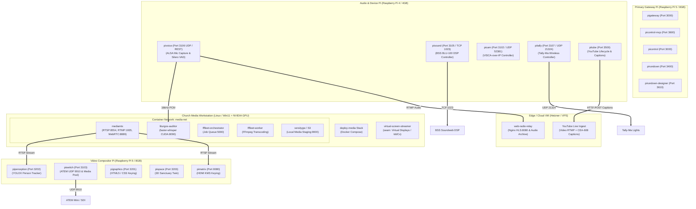

# Deployment Plan: Pi Ecosystem & Adjacent Media Stack

This document specifies the production deployment architecture, host topology, hardware placement, and operational runbook for the **Pi Production Ecosystem** and its adjacent containerized media services (`mediamtx`, `liturgos-auditor`, `fffleet`, `web-radio-relay`) powering Riihimäen Keskuskirkko.

---

## 1. Physical Host & Node Topology

The ecosystem is distributed across specialized edge Raspberry Pi nodes, an on-premise Church Media Workstation, and an optional remote/cloud VM for listener fanout:



---

## 2. Service Placement & Matrix

| Host Node | Service | Port | Runtime | Launch Command / Systemd Unit |
|---|---|---|---|---|
| **Workstation** | `mediamtx` | `8554`, `1935`, `8888`, `8889` | Docker (bluenviron/mediamtx) | `./deploy up -d` in `D:\deploy-media` |
| **Workstation** | `liturgos-auditor` | `8090` | Docker (CUDA GPU) | `compose.gpu.yml` via `deploy-media` |
| **Workstation** | `fffleet-orchestrator` | `5000` | Docker (ghcr.io/jsilvanus/fffleet) | Included in `deploy-media` |
| **Workstation** | `fffleet-worker` | Dynamic | Docker | Included in `deploy-media` |
| **Workstation** | `virtual-screen-streamer` (seam) | Dynamic | .NET 9 WPF Service | `PiMatrixCompanion.exe` |
| **Gateway Pi** | `pigateway` | `3000`, UDP `3101`, `3102` | Node 24 (Fastify) | `systemctl start pigateway` |
| **Gateway Pi** | `picontrol-mcp` | `3600` | Node 24 (TypeScript) | `systemctl start picontrol-mcp` |
| **Gateway Pi** | `picontrol` | `5173` (dev) | Node 22+ (React/Vite) | `systemctl start picontrol` |
| **Gateway Pi** | `pirundown` | `3400` | Node 22+ (Fastify) | `systemctl start pirundown` |
| **Gateway Pi** | `pirundown-designer` | `3610` | Node 22+ (Fastify/React) | `systemctl start pirundown-designer` |
| **Video Pi** | `pimatrix` | `8080`, `8081` | Node 24 + GStreamer | `systemctl start pimatrix` |
| **Video Pi** | `piswitch` | `3103`, ATEM `9910` | Node 22+ (Fastify) | `systemctl start piswitch` |
| **Video Pi** | `pigraphics` | `3201` | Node 22+ (Fastify) | `systemctl start pigraphics` |
| **Video Pi** | `pispace` | `3203` | Node 22+ (Fastify) | `systemctl start pispace` |
| **Video Pi** | `piperception` | `3202` | Node 22+ (ONNX Runtime) | `systemctl start piperception` |
| **Audio Pi** | `pivoice` | `3106` UDP / REST | Node 24 (ALSA + Silero) | `systemctl start pivoice` |
| **Audio Pi** | `pisound` | `3105`, Soundweb `1023` | Node 22+ (Fastify) | `systemctl start pisound` |
| **Audio Pi** | `picam` | `3102`, VISCA `52381` | Node 24 (Fastify) | `systemctl start picam` |
| **Audio Pi** | `pitally` | `3107`, UDP `21324` | Node 22+ (Fastify) | `systemctl start pitally` |
| **Audio Pi** | `pitube` | `3500` | Node 22+ (Fastify) | `systemctl start pitube` |
| **Cloud VM** | `web-radio-relay` | `8080`, `1935`, `3000` | Docker (Nginx + Node) | `docker compose up -d` |

---

## 3. Step-by-Step Deployment Procedure

### Phase A: Infrastructure & Adjacent Media Stack (`deploy-media`)

1. **Verify Docker and GPU Support on Workstation**:
   ```bash
   docker --version
   docker compose version
   nvidia-smi   # verify NVIDIA CUDA drivers if GPU is active
   ```
2. **Configure Environment in `D:\deploy-media`**:
   ```bash
   cd D:\deploy-media
   node setup.mjs
   ```
   *Answers*:
   - Local or Traefik overlay: Select `local` for on-prem church LAN.
   - GPU support: Enable CUDA overlay if NVIDIA GPU is present.
   - S3 Storage: Bundled `versitygw` (stores objects locally in `s3_data`).
3. **Launch the Container Stack**:
   ```bash
   # On Windows PowerShell
   .\deploy.ps1 up -d
   # or node deploy.mjs up -d
   ```
4. **Smoke-Test Core Media Services**:
   - MediaMTX: `curl http://localhost:8889`
   - Liturgos Auditor STT: `curl http://localhost:8090/health` (waits until Whisper model weights load)
   - FFFleet Orchestrator: `curl http://localhost:5000/health`
   - Open FFFleet dashboard at `http://127.0.0.1:5000/ui/`

---

### Phase B: Gateway & Orchestration Plane (`pigateway`, `picontrol`, `pirundown`)

1. **Configure `pigateway` environment** (`.env`):
   ```env
   PIGATEWAY_PORT=3100
   PIGATEWAY_MODE=production
   PIGATEWAY_API_KEY=<random-secret-token>
   PIGATEWAY_AUDITOR_URL=http://<workstation-ip>:8090
   PIGATEWAY_MEDIAMTX_RTSP_URL=rtsp://<workstation-ip>:8554
   PIGATEWAY_PIRUNDOWN_API_URL=http://127.0.0.1:3400
   PIGATEWAY_PISPACE_API_URL=http://<video-pi-ip>:3108
   PIGATEWAY_PIGRAPHICS_API_URL=http://<video-pi-ip>:3107
   PIGATEWAY_PIPERCEPTION_API_URL=http://<video-pi-ip>:3110
   ```
2. **Start Gateway and Orchestrator Services**:
   ```bash
   # In D:\pigateway
   npm run build && npm start

   # In D:\pirundown
   npm start

   # In D:\pirundown-designer
   npm start

   # In D:\picontrol
   npm start
   ```

---

### Phase C: Video Compositing & Perception Plane (`pimatrix`, `piswitch`, `pigraphics`, `pispace`, `piperception`)

1. **Configure Camera Streams in `mediamtx.yml`**:
   Point RTSP feeds to PTZ cameras:
   ```yaml
   paths:
     cam1:
       source: rtsp://192.168.1.101:554/live/ch0
     cam2:
       source: rtsp://192.168.1.102:554/live/ch0
   ```
2. **Start Switcher & Graphics**:
   - `piswitch`: Connects to physical ATEM (UDP 9910) on LAN IP.
   - `pigraphics`: Serves HTML5 lower-third templates and DSK keying buffers.
   - `piperception`: Consumes camera preview frames and begins ByteTrack bounding box tracking.
   - `pispace`: Triangulates 2D bounding boxes with FreeD PTZ angles to maintain real-time 3D sanctuary coordinates.

---

### Phase D: Audio Ingest, DSP & Caption Egress (`pivoice`, `pisound`, `pitube`, `pitally`)

1. **Verify USB Audio & BSS DSP Connectivity**:
   - USB Hama Mic on Audio Pi: Verify with `arecord -l`.
   - BSS BLU-100 DSP: Confirm TCP connection on `192.168.1.10:1023`.
2. **Start Audio and Egress Services**:
   - `pivoice`: Captures mic, Silero VAD gates speech, streams 16kHz PCM to `liturgos-auditor`.
   - `pitube`: Authenticates with YouTube OAuth2 refresh token, attaches to `pigateway` transcript SSE bus, begins 30s-delayed timed CEA-608 caption ingestion.
   - `pitally`: Discovers Tally-Ma devices via mDNS (`tally01.local`, `tally02.local`) and initializes 9-LED color zones.

---

## 4. Verification & Health Monitoring Runbook

To verify full ecosystem readiness before a live Sunday worship service:

1. **Run Cross-Repo Git & Status Check**:
   ```bash
   node D:\piecosystem\scripts\ecosystem-status.mjs
   ```
2. **Probe All Services via `picontrol CLI`**:
   ```bash
   picontrol ecosystem probe
   ```
3. **Verify Audio Pipeline Health**:
   ```bash
   picontrol voice status
   picontrol sound status
   ```
4. **Test Video Mixer & Lower-Third Triggering**:
   ```bash
   picontrol atem preview 2
   picontrol graphics show lower-third-speaker 5000
   ```
5. **Check YouTube Broadcast Ready State**:
   ```bash
   picontrol youtube list
   ```

---

## 5. Failover & Disaster Recovery Procedures

1. **Physical ATEM Switcher Offline**:
   - `piswitch` automatically falls back to local software mixer mode using GStreamer & MediaMTX pipelines.
2. **Workstation / GPU STT Failure**:
   - If `liturgos-auditor` becomes unreachable, `pigateway` reports `auditor: available=false` and logs warnings. `pitube` gracefully holds caption queue without aborting the YouTube video broadcast.
3. **Loss of mDNS on Tally-Ma Lights**:
   - `pitally` automatically falls back from `tallyXX.local` to configured static DHCP fallback IPs (`192.168.1.70+`) without interrupting live tally cues.
4. **Internet Disconnection**:
   - Sanctuary PA (`pisound`), in-house video matrix (`pimatrix`), slide projection (`piprogram`), and tallies continue functioning on local LAN without cloud dependency.