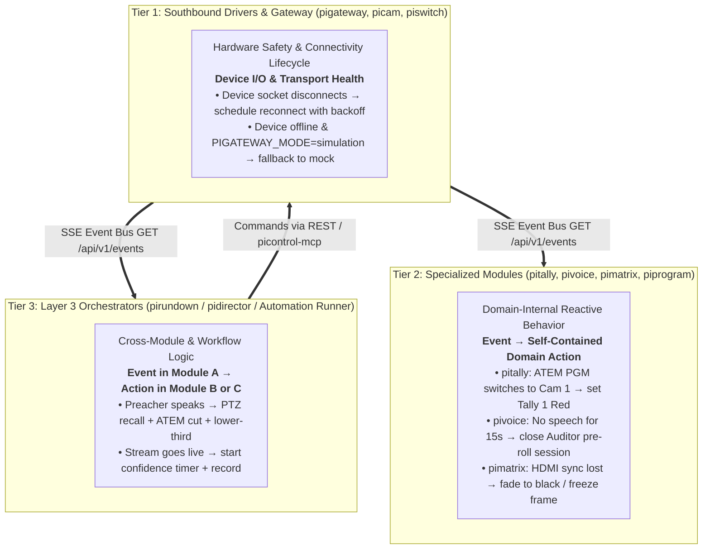

# Event Conditionals & Automation Placement Guidelines

This architectural guide defines where conditional logic (*"When event X happens, do action Y"*) belongs within the **Pi Production Ecosystem (`piecosystem`)**. It establishes clear boundaries between low-level hardware drivers, domain-specific modules, the central gateway, and workflow orchestrators.

---

## 1. Executive Summary: The 3-Tier Rule

When deciding where a conditional or trigger should live, apply the **3-Tier Placement Model**:



| Classification | Where It Lives | Primary Projects | Example |
|---|---|---|---|
| **Device / Transport Safety** | **`pigateway`** (or hardware driver) | `pigateway`, `picam`, `piswitch` | Reconnect TCP socket on drop; failover to simulation mode if offline. |
| **Domain-Internal Reactivity** | **Inside the specific module** | `pitally`, `pivoice`, `pimatrix`, `piprogram` | `pitally` observes PGM changes on SSE bus and updates its own LEDs. |
| **Cross-Module Orchestration** | **Layer 3 Orchestrators** | `pirundown`, `pidirector`, or automation engine | Speech detected $\rightarrow$ cue camera preset $\rightarrow$ switch video $\rightarrow$ trigger graphic overlay. |

---

## 2. Why Conditionals Do NOT Belong in `pigateway`

[`pigateway`](file:///d:/pigateway) is the **Southbound Hardware Gateway and Event Broker** (spanning Layer 1 and the Layer 3 event boundary). It abstracts physical hardware (ATEM, AMX NetLinx, PTZ cameras, Matrox Monarch HDX) behind unified REST endpoints and broadcasts real-time state changes via Server-Sent Events (`GET /api/v1/events`).

Placing business conditionals or workflow triggers inside `pigateway` is an anti-pattern for three reasons:

1. **Violation of the Single Responsibility Principle (SRP)**:
   - `pigateway`'s mission is **protocol translation, hardware I/O, authoritative state caching, and event transport**.
   - If `pigateway` evaluates business rules (e.g. checking whether a hymn is active before switching cameras), it must know about liturgy, slide states, rundowns, and high-level venue workflows, becoming a fragile monolithic bottleneck.

2. **Fault Isolation & Blast Radius**:
   - The gateway maintains critical persistent connections (UDP 9910 to ATEM, VISCA UDP 52381 to cameras, AMX TCP 6501/6600).
   - If a complex conditional rule crashes, enters an infinite loop, or blocks the Node event loop, the entire physical hardware control plane fails.

3. **Inversion of Control**:
   - In distributed event-driven systems: *"Dumb pipes, smart endpoints."*
   - `pigateway` is the pipe that reliably publishes facts (*"ATEM PGM is now input 2"*, *"Cam 1 Pan is 142.5°"*). Consuming services decide what those facts mean and what actions to take.

> [!IMPORTANT]
> **The Gateway Exception**: The *only* conditionals permitted in `pigateway` are **hardware transport and driver lifecycle rules** (e.g., reconnect timers, health heartbeats, simulation fallbacks, and telemetry TTL expiration).

---

## 3. When Conditionals Belong in Individual Modules

Conditionals belong inside an individual module **only when the condition and the resulting action fall strictly within that module's own bounded domain**.

### Characteristics of Module-Internal Conditionals:
- The module consumes a state change (either from its internal state or from `pigateway`'s SSE bus).
- The action taken only mutates the module's own internal hardware, stream, or buffer.
- The module **does not** command or invoke other external modules.

### Concrete Examples:
- **`pitally`**: Listens to the `atem` event on `pigateway`'s SSE bus. When `pgmInput === 1`, it immediately fires UDP datagrams to illuminate Tally light #1 RED. This is `pitally`'s core domain responsibility; no external orchestrator is needed to tell `pitally` how to drive tallies.
- **`pivoice`**: When internal Silero VAD detects speech inactivity exceeding `PIGATEWAY_PIVOICE_IDLE_CLOSE_SECONDS`, it automatically tells its internal capture session to close and flushes its rolling PCM pre-roll buffer to Auditor.
- **`pimatrix`**: When a video HDMI sink loses signal sync, its internal DRM/KMS supervisor automatically displays a black frame or test pattern to prevent projector flicker.

### Anti-Pattern: Peer-to-Peer Spaghetti
```
[pivoice] --(HTTP POST)--> [picam] --(HTTP POST)--> [piswitch]  <-- ANTI-PATTERN!
```
Modules must **never** call other sibling modules directly to chain conditional actions. This causes circular dependencies, uncoordinated execution order, and impossible-to-debug race conditions.

---

## 4. Where Cross-Module Conditionals Belong: Layer 3 Orchestrators

When an event originating in **Service A** needs to trigger an action in **Service B and Service C**, the logic belongs in **Layer 3 (Orchestration & Workflow Plane)**:

```
[Service A: pivoice] 
       │ (SSE Event: speech_detected)
       ▼
[Layer 3 Orchestrator: pirundown / pidirector / rule runner]
       │
       ├─(1) POST /api/v1/cameras/1/preset/2 ──> [picam]
       ├─(2) POST /api/v1/atem/cut ─────────────> [piswitch]
       └─(3) POST /api/v1/graphics/lower-third ─> [pigraphics]
```

### The Three Orchestration Engines in the Ecosystem:

1. **Liturgical & Run-of-Show Cues $\rightarrow$ [`pirundown`](file:///d:/pirundown)**:
   - For planned, deterministic workflows defined in YAML v2 cue sheets.
   - Example: *"When the cue advances to 'Opening Prayer', transition the slide overlay, switch camera 1 to the altar, and unmute the altar mic."*

2. **Autonomous / Real-Time Media Directing $\rightarrow$ [`pidirector`](file:///d:/piecosystem/docs/pidirector-architecture-plan.md)**:
   - For dynamic AI-driven production decisions during live broadcasts using local Ollama LLMs.
   - Example: *"When `pispace` reports a person entered the pulpit zone and `pivoice` confirms active speech, frame pulpit on Preview, wait 1.5 seconds, then cut ATEM."*

3. **Stateless AI Agent / Operator Automation $\rightarrow$ [`picontrol-mcp`](file:///d:/picontrol-mcp)**:
   - For agentic or human-triggered complex workflows through unified Model Context Protocol tools.

---

## 5. Architectural Decision Matrix

Use this checklist whenever designing a new conditional feature:

```
Does the rule trigger actions across multiple distinct modules?
  ├── YES ──> Place in Layer 3 Orchestration (pirundown, pidirector, or rule runner).
  └── NO  ──> Does it control another service or broad venue policy?
                ├── YES ──> Place in Layer 3 Orchestration.
                └── NO  ──> Is it low-level hardware I/O, socket retry, or mock fallback?
                              ├── YES ──> Place in pigateway or device driver.
                              └── NO  ──> Place in the specific module (e.g. pitally, pivoice).
```

### Summary Reference Table

| Requirement | Correct Location | Incorrect Location | Rationale |
|---|---|---|---|
| Auto-reconnect camera on TCP drop | `pigateway` / `picam` | `pirundown` | Low-level transport resilience belongs at the driver/gateway layer. |
| Set tally light based on ATEM program | `pitally` | `pigateway` | Tally display is the dedicated domain of `pitally`, consuming gateway SSE. |
| Close audio recording session on 15s silence | `pivoice` / coordinator | `pigateway` core | Audio DSP signal timing belongs to the audio capture service. |
| Preacher steps up $\rightarrow$ Recall preset $\rightarrow$ Cut ATEM | `pidirector` / `pirundown` | `pigateway` or `picam` | Cross-module orchestration requires high-level production context. |
| Hymn slide change $\rightarrow$ Update matrix DSK overlay | `pirundown` / `piprogram` | `pigateway` | Content presentation lifecycle belongs to presentation engines. |
