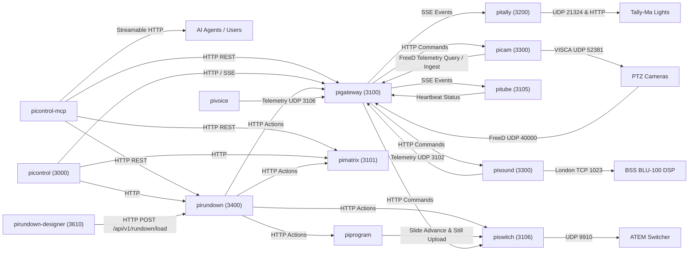

# Inter-Service Communication & Ports Matrix

This document defines the network topology, listening ports, communication protocols, and security boundaries across the Pi ecosystem.

---

## 1. Network Ports Registry

| Port | Protocol | Service / Component | Purpose | Interface Type |
|---|---|---|---|---|
| **161** | UDP | PLANET GS-4210-16P2S | SNMP v2c, polled on demand by `pipoe` | SNMP |
| **1023** | TCP | BSS Soundweb BLU-100 | Harman London Direct Inject | TCP binary protocol |
| **1935** | TCP/RTMP | `mediamtx` / `web-radio-relay` | RTMP video and audio ingestion | Streaming media |
| **3000** | HTTP | `pigateway` | Central hardware gateway & event bus | REST API & SSE (`/events`) |
| **3101** | UDP | `pigateway` | PiVoice audio telemetry ingestion | Binary/JSON UDP datagrams |
| **3102** | HTTP | `picam` | PTZ camera service API | REST API |
| **3102** | UDP | `pigateway` | PiSound DSP telemetry ingestion | Binary/JSON UDP datagrams |
| **3103** | HTTP | `piswitch` | Universal video mixer (ATEM/software) | REST API & SSE |
| **3104** | HTTP | `piencoder` | Multi-unit hardware streaming encoder controller (Matrox Monarch HDX) | REST API & SSE (`/events`) |
| **3105** | HTTP | `pisound` | Sound & microphone service API | REST API |
| **3107** | HTTP | `pitally` | Tally light controller API | REST API |
| **3108** | HTTP | `pipoe` | PoE switch controller (PLANET switch via SNMP) | REST API |
| **3109** | HTTP | `pinotify` | Notifications built on `notify-core` (skeleton, not installed on the Pi) | REST API |
| **3200** | HTTP | `piprogram` | Hymns, slides, PPTX pipeline, three program feeds (PiPGM1-3) and PA audio control | REST API & SSE (`/api/v1/events`) |
| **3201** | HTTP | `pigraphics` | Broadcast graphics engine & live Fill/Key streaming | REST API & SSE (`/api/v1/graphics/events`) |
| **3202** | HTTP | `piperception` | Real-time person detection & ByteTrack tracking | REST API, SSE & Web UI |
| **3203** | HTTP | `pispace` | Spatial engine, 3D venue digital twin & solver | REST API & SSE (`/events`) |
| **3300** | HTTP | `piembed` | Vector embedding & semantic cue matching engine (Ollama + Hugging Face ONNX) | REST API |
| **3301** | HTTP | `piagent` | Centralized Agent Infrastructure Plane (LangGraph, AI SDK, MCP) | REST API & SSE (`/api/v1/agent/events`) |
| **3400** | HTTP | `pirundown` | Service rundown engine API | REST API & SSE |
| **3401** | HTTP | `pidirector` | Local AI Stream Director engine | REST API & SSE (`/api/v1/director/stream`) |
| **3500** | HTTP | `pitube` | YouTube lifecycle & caption coordinator | REST API |
| **3600** | HTTP | `picontrol-mcp` | MCP Server for AI agents (`pi://`) | Streamable HTTP |
| **3610** | HTTP | `pirundown-designer` | Visual authoring & cue-sheet designer for Rundown v2 YAML | Web UI & REST API |
| **3700** | HTTP | `pistorage` | Shared object storage: S3-compatible backend (VersityGW / Hetzner) with Pi read-through disk cache (binds 127.0.0.1 on the Pi) | REST API |
| **5000** | HTTP | `fffleet-orchestrator` | Fleet job queue API & Web Dashboard (`/ui/`) | REST API & Web UI |
| **5101+** | HTTP | `fffleet-worker` | Worker process & daemon job execution | REST API |
| **5173 (dev)** | HTTP | `picontrol` | Human Operator Web UI server | Web UI & API Proxy |
| **6501 / 6600** | TCP | `pigateway` | AMX NetLinx master communication | Raw TCP socket |
| **6601** | TCP | `pigateway` / `pimatrix` | Forwarded video AMX command line | Raw TCP socket |
| **3101** | HTTP | `pimatrix` | Video routing & compositor API (port map of 2026-11-02; the UDP `3101` of `pigateway` is a different protocol) | REST API & WebSocket |
| **8080** | HTTP | `picontrol` UI (Pi) | Operator UI served on the Pi (`projector-relay` is on 127.0.0.1:3180) | Web UI |
| **8080** | HTTP | `web-radio-relay` | HLS audio streaming & archive MP3 files | HTTP file server |
| **8090** | HTTP | `liturgos-auditor` | Speech-to-text inference API & live SSE | REST API & SSE (`/v1/live`) |
| **8554** | TCP/RTSP | `mediamtx` | RTSP live camera streaming crossbar | Streaming media |
| **8888** | HTTP | `mediamtx` | HLS video output | HTTP video |
| **8889** | HTTP/WebRTC | `mediamtx` | Low-latency WebRTC (Whip/Whep) stream | WebRTC media |
| **9910** | UDP | ATEM Switcher | Blackmagic ATEM hardware protocol | UDP binary packets |
| **11434** | HTTP | `ollama` | Local LLM inference server (Llama 3.2, Qwen 2.5) | HTTP REST API |
| **21324** | UDP | Tally-Ma Lights | 29-byte multi-segment LED protocol | UDP binary broadcast |
| **40000** | UDP | `pigateway` | FreeD camera tracking telemetry | UDP binary datagrams |
| **52381** | UDP | PTZ Cameras | Sony / AVer VISCA-over-IP | UDP binary packets |

---

## 2. Service-to-Service Communication Topology

---

## 3. Communication Protocols & Standards

### A. Control Plane Protocols
1. **HTTP/REST + JSON**:
   - Primary request/response mechanism for all control operations.
   - Built on Node 22/24 Fastify with strict request validation using Zod or OpenAPI schemas.
2. **Server-Sent Events (SSE)**:
   - Primary one-way real-time telemetry channel (e.g., `GET /api/v1/events` on `pigateway`, `/api/v1/video-mixer/events` on `piswitch`).
   - Keeps browser interfaces and background microservices synchronized without aggressive polling.
3. **Model Context Protocol (MCP)**:
   - Implemented via Streamable HTTP (`picontrol-mcp`) to expose stack tools and virtual resources (`pi://`) to Large Language Model agents.
4. **Binary UDP / TCP Device Protocols**:
   - **VISCA-over-IP** (UDP 52381): Camera motion, presets, zoom.
   - **Harman London DI** (TCP 1023): Audio DSP parameter control.
   - **ATEM UDP** (UDP 9910): Program/preview video bus switching.
   - **Tally-Ma UDP** (UDP 21324): 29-byte frame setting 9 RGB LEDs.

### B. Media (Data) Plane Protocols (Isolated)
- **RTSP / SRT / WebRTC**: Ingesting raw IP camera feeds into `pimatrix`.
- **RTMP**: Screen casting from Windows presenter PC (`virtual-screen-streamer`, a seam project) to `pimatrix`.
- **Raw PCM Audio (16 kHz mono S16LE)**: Streamed directly from `pivoice` to `liturgos-auditor`.
- **HLS / Icecast**: Outbound parish radio streaming from `web-radio-relay`.
- **CEA-608 / HTTP POST**: Outbound timed live closed captions from `pitube` to YouTube Live ingestion servers.

---

## 4. Security & Authentication Model

1. **Bearer Token Authentication**:
   - Inter-service REST mutating endpoints (`POST`, `PUT`, `PATCH`, `DELETE`) require bearer tokens configured via environment variables (e.g., `PIGATEWAY_API_KEY`).
2. **Host-Based Whitelisting**:
   - Internal local processes on loopback (`127.0.0.1` or configured `AUTH_ALLOWED_HOSTS`) bypass authentication tokens for zero-overhead local daemon IPC.
3. **MCP Access Rights & Scopes**:
   - `picontrol-mcp` enforces fine-grained domain roles (`routing`, `cameras`, `atem`, `program`, `composites`, `voice`, `youtube`, `tally`, `radio`, `system`):
     - `viewer`: Read-only queries across resources.
     - `operator`: Standard service execution (cutting cameras, advancing slides, adjusting mics).
     - `admin`: High-impact settings (preset overwrites, matrix locking, voice configuration).
4. **Secret Isolation**:
   - Sensitive credentials (YouTube OAuth refresh tokens, RTMP stream keys, private API keys) are strictly contained inside their respective microservices (`pitube`, `pigateway`) and masked in logs, status responses, and MCP audits.
