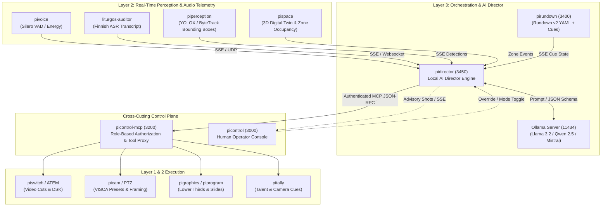
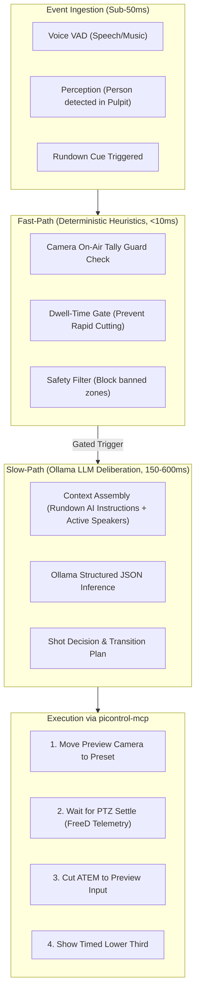

# `pidirector` — Local AI Broadcast Director Architecture Plan

## Executive Summary

`pidirector` is an autonomous and semi-autonomous **Local AI Stream Director** engineered specifically for live worship services at **Riihimäen Keskuskirkko**. Operating within the Pi Ecosystem (`piecosystem`), it orchestrates camera framing, ATEM video switching, broadcast graphics, and rundown progression using a strictly **local Large Language Model via Ollama**.

### Core Tenets
1. **100% Local Inference**: Zero cloud reliance and zero latency spikes. Local execution protects parishioner privacy (GDPR) and guarantees stream continuity even during WAN outages.
2. **Context-Driven Direction via Rundown v2**: Directorial decisions are steered by deterministic liturgical cues combined with general and section-specific AI instructions embedded directly into the Rundown v2 cue sheet.
3. **Role-Based Least Privilege via MCP**: All hardware commands are issued through `picontrol-mcp` using a dedicated `director` role, ensuring strict permission boundaries, safety guardrails, and audit logging.
4. **Dual Operation Modes**: Operates either as an **Autonomous Director** (direct execution) or as a **Co-Pilot / Advisory Assistant** (suggesting shots to the human operator in `picontrol`).

---

## 1. High-Level Architecture & Ecosystem Placement



---

## 2. Rundown v2 Schema Extension: AI Instructions

To enable intelligent directorial decision-making, the Rundown v2 specification in `pirundown` is extended with an `ai` block at both the **document level (general)** and the **item/section level**.

### 2.1 Zod Schema Additions (`D:\pirundown\src\schema\rundown-v2.ts`)

```typescript
import { z } from "zod";

// --- AI Instruction Schemas ---

export const AiPacingSchema = z.enum(["meditative", "calm", "liturgical", "dynamic", "brisk"]).default("liturgical");
export const AiFramingSchema = z.enum(["wide", "medium", "close", "extreme-close", "over-shoulder", "ambient"]).default("medium");

export const AiShotRuleSchema = z.object({
  condition: z.string().describe("Contextual condition e.g. 'preacher_speaking', 'choir_singing'"),
  target: z.string().describe("Camera and preset, e.g. 'cam:2:preset:pulpit'"),
  priority: z.number().min(1).max(10).default(5),
});

export const AiConstraintsSchema = z.object({
  disallowCongregationCloseup: z.boolean().default(true),
  minShotDwellSec: z.number().positive().default(4),
  maxShotDwellSec: z.number().positive().default(30),
  avoidCutsDuringPrayer: z.boolean().default(true),
  disallowMoveWhileOnAir: z.boolean().default(true),
});

/** Global AI instructions for the entire broadcast */
export const AiGeneralInstructionsSchema = z.object({
  pacing: AiPacingSchema.optional(),
  style: z.string().optional().describe("Overall visual narrative, e.g. 'Reverent Nordic Lutheran liturgy'"),
  guidelines: z.array(z.string()).default([]),
  constraints: AiConstraintsSchema.default({}),
  cameraRoles: z.record(z.string(), z.string()).optional().describe("e.g. { '1': 'Wide altar/sanctuary', '2': 'Pulpit & lectern medium', '3': 'Organ & choir' }"),
  sections: z.record(z.string(), z.string()).optional().describe("Fallback directorial instructions keyed by section name"),
});

/** Per-item / per-cue AI instructions */
export const AiItemInstructionsSchema = z.object({
  instructions: z.string().describe("Directorial guidelines for this specific moment"),
  targetZone: z.enum(["altar", "pulpit", "ambo", "choir", "organ", "congregation", "wide"]).optional(),
  primarySubject: z.string().optional().describe("e.g. 'Liturgist', 'Preacher', 'Choir'"),
  preferredCameras: z.array(z.union([z.number(), z.string()])).optional(),
  framing: AiFramingSchema.optional(),
  pacing: AiPacingSchema.optional(),
  minDurationSec: z.number().nonnegative().optional(),
  shotRules: z.array(AiShotRuleSchema).optional(),
  graphicsCue: z.object({
    lowerThird: z.object({
      title: z.string(),
      subtitle: z.string().optional(),
      autoShowSec: z.number().optional(),
    }).optional(),
  }).optional(),
});

export type AiGeneralInstructions = z.infer<typeof AiGeneralInstructionsSchema>;
export type AiItemInstructions = z.infer<typeof AiItemInstructionsSchema>;
```

### 2.2 Integration into Top-Level Rundown & Items

```typescript
// Updating RundownSubitemSchema & RundownItemSchema:
export const RundownItemSchema = z.lazy(() =>
  z.object({
    id: z.string().min(1).optional(),
    title: z.string().min(1).optional(),
    section: z.string().optional(),
    notes: z.string().optional(),
    ai: AiItemInstructionsSchema.optional(), // <-- Item-specific AI instructions
    cue: CueSchema.optional(),
    actions: z.array(ActionItemSchema).default([]),
    subitems: z.array(RundownSubitemSchema).optional(),
    items: z.array(RundownItemSchema).optional(),
  })
);

// Updating Top-Level RundownV2Schema:
export const RundownV2Schema = z.object({
  version: z.literal(2),
  title: z.string().min(1),
  service: z.string().optional(),
  church: z.string().optional(),
  date: z.string().optional(),
  ai: AiGeneralInstructionsSchema.optional(), // <-- Global broadcast AI instructions
  connectors: z.record(ConnectorDefSchema).optional(),
  preflight: PreflightSchema.optional(),
  rundown: z.array(RundownItemSchema).min(1),
});
```

### 2.3 Example YAML Usage (`sunday-mass.yaml`)

```yaml
version: 2
title: "Messu"
service: "Päiväjumalanpalvelus"
church: "Riihimäen Keskuskirkko"
date: "2026-11-01"

ai:
  pacing: "liturgical"
  style: "Dignified, calm, contemplative church service. Smooth, deliberate cuts."
  cameraRoles:
    "1": "Wide altar and sanctuary view"
    "2": "Pulpit (saarnatuoli) and ambo close/medium"
    "3": "Organ loft and choir"
  constraints:
    disallowCongregationCloseup: true
    minShotDwellSec: 5
    maxShotDwellSec: 35
    avoidCutsDuringPrayer: true
  guidelines:
    - "Never cut to an empty podium or unlit zone."
    - "When hymns or organ play, cut to choir/organ or wide sanctuary; do not linger on silent celebrant."
    - "Maintain wide establishing shot during communion distribution to protect attendee privacy."

rundown:
  - id: "saarna"
    title: "Saarna (Sermon)"
    section: "Sana"
    notes: "Preacher delivers sermon from pulpit."
    ai:
      instructions: |
        Focus primarily on preacher at the pulpit. Use Cam 2 medium framing.
        If preacher speaks with passion or pauses dramatically, avoid switching.
        Cut to Cam 1 wide shot only if preacher references the altar fresco or makes extended liturgical gesture.
      targetZone: "pulpit"
      primarySubject: "Preacher"
      preferredCameras: [2, 1]
      framing: "medium"
      pacing: "calm"
      graphicsCue:
        lowerThird:
          title: "Saarna"
          subtitle: "{{preacher}}"
          autoShowSec: 10
    cue:
      type: "fuzzy"
      phrase: "Aamen. Saarnan teksti"
      threshold: 0.80
    actions:
      - cam: { id: 2, preset: "pulpit" }
      - switch: { cut: 2 }
```

---

## 3. Role-Based Auth (RBAC) via `picontrol-mcp`

`pidirector` does not communicate directly with physical hardware sockets (ATEM UDP 9910, VISCA UDP 52381, BSS Soundweb TCP 1023). Instead, it authenticates against **`picontrol-mcp`** via **Streamable HTTP**.

### 3.1 Permission Architecture Analysis
In `picontrol-mcp` (`src/users/permissions.ts`):
- **Domains**: `routing`, `cameras`, `atem`, `program`, `composites`, `voice`, `youtube`, `tally`, `radio`, `encoder`, `system`, `world`, `space`, `perception`, `sound`, `rundown`, `graphics`.
- **Levels**: `read`/`view` (1), `write`/`operate` (2), `admin` (3), `config` (6), `setup` (7).
- **Scopes**: `church`, `stream`, `radio`, `event`, `hardware`.

### 3.2 Defining the `director` Role in `picontrol-mcp`

In `~/.config/picontrol-mcp/users.json` (or built-in `BUILT_IN_ROLES`):

```json
{
  "roles": {
    "director": [
      "cameras:operate",
      "atem:operate",
      "program:operate",
      "composites:operate",
      "tally:operate",
      "rundown:operate",
      "graphics:operate",
      "perception:view",
      "space:view",
      "voice:view",
      "sound:view",
      "routing:view",
      "system:read",
      "*:read"
    ]
  }
}
```

#### Denials and Safety Enforcements
`pidirector` is explicitly denied:
- `youtube:write` & `youtube:admin` (AI cannot stop or delete the live YouTube stream).
- `system:admin` (AI cannot reboot hosts or change credentials).
- `routing:setup` & `routing:admin` (AI cannot alter matrix routing locks or encoder sinks).
- `perception:setup` & `voice:config` (AI cannot overwrite neural models or ALSA buffer sizes).

### 3.3 Provisioning `pidirector` User & Token

```bash
# Provision user in picontrol-mcp
npm run user -- add pidirector --role director
# Issue long-lived service token for pidirector
npm run user -- token create pidirector --label "pidirector-core" --days 365
# Result: pcm_director_a87f9e...
```

### 3.4 MCP Runtime Flow
1. `pidirector` establishes Streamable HTTP connection to `http://localhost:3200/mcp` with header `Authorization: Bearer pcm_director_...`.
2. `picontrol-mcp` reads `users.json` on each request and filters tool listing. Only tools permitted under the `director` role are presented:
   - Allowed: `atem_switch`, `camera_move`, `camera_preset`, `rundown_cue_next`, `lower_third`, `tally_cue`.
   - Hidden & Denied: `youtube_broadcast_stop`, `system_whoami` admin flags, `perception_configure`.
3. Every directorial command is logged in `picontrol-mcp`'s audit log with caller ID `pidirector` and timestamp.

---

## 4. Local AI & Ollama Pipeline

### 4.1 Two-Tier Decision Architecture
To meet live broadcasting time constraints, `pidirector` implements a two-speed control loop:



### 4.2 Recommended Local Models via Ollama
- **Tier 1 (Fast & Agile)**: `llama3.2:3b` or `qwen2.5:3b-instruct`
  - Inference latency: ~100–180ms on GPU/M-series.
  - Role: Rapid camera shot selection, shot fatigue evaluation, and dynamic reframing.
- **Tier 2 (Rich Liturgical Reasoning)**: `qwen2.5:7b-instruct` or `mistral:7b-instruct-v0.3`
  - Inference latency: ~300–600ms.
  - Role: Cue transition analysis, understanding theological sermon context, multi-camera sequencing.

### 4.3 Ollama Structured Prompt Contract

`pidirector` prompts Ollama using `format: "json"` with a strict JSON schema:

```json
{
  "thought": "Preacher just stepped to pulpit. Rundown specifies Cam 2 medium shot with lower-third.",
  "recommendedAction": "cut",
  "prepareCamera": {
    "camera": 2,
    "preset": "pulpit_medium"
  },
  "cutToInput": 2,
  "transition": "cut",
  "graphics": {
    "showLowerThird": true,
    "title": "Saarna",
    "subtitle": "Pastori Matti"
  },
  "rationale": "Adheres to Sana section AI instructions for preacher focus."
}
```

---

## 5. Directorial Logic & Safety Guardrails

### Guardrail Matrix
| Risk Scenario | Safety Mechanism in `pidirector` |
|---|---|
| **Moving an On-Air Camera** | Checks ATEM PGM tally before issuing VISCA commands. Never moves a camera currently on PGM. Moves PRV camera first, waits for FreeD settle, then CUTs. |
| **Rapid Shot Toggling (Flicker)** | Strict minimum dwell time (`minShotDwellSec = 4s`). Suppresses new cuts until dwell time expires. |
| **Privacy Invasions** | Blacklisted zones (congregation communion line, private prayer postures) as defined in Rundown v2 `constraints.disallowCongregationCloseup`. |
| **Empty Podium Cut** | Cross-validates with `piperception` bounding boxes. If zero people are detected in `pulpit` zone, falls back to wide altar shot. |
| **Ollama Timeout or Failure** | 800ms watchdog timer. If Ollama inference drops or stalls, falls back to deterministic Rundown v2 default action. |

---

## 6. Implementation Roadmap

```mermaid
timeline
    title pidirector Implementation Timeline
    section Phase 1 : Rundown v2 AI Schema
      Update rundown-v2.ts in pirundown : 1d
      Add YAML parser unit tests : 1d
      Update sunday-mass.yaml example : 0.5d
    section Phase 2 : MCP Role & Setup
      Add director role to picontrol-mcp : 0.5d
      Create pidirector service user & token : 0.5d
      Implement director domain in MCP : 1d
    section Phase 3 : Core pidirector Engine
      Fastify daemon & Ollama client : 2d
      SSE Ingest (pigateway, piperception, pivoice) : 2d
      Two-speed decision loop & safety guardrails : 3d
    section Phase 4 : Operator UI & Verification
      picontrol director status panel & overrides : 2d
      End-to-end dry run with recorded Sunday mass : 2d
```
