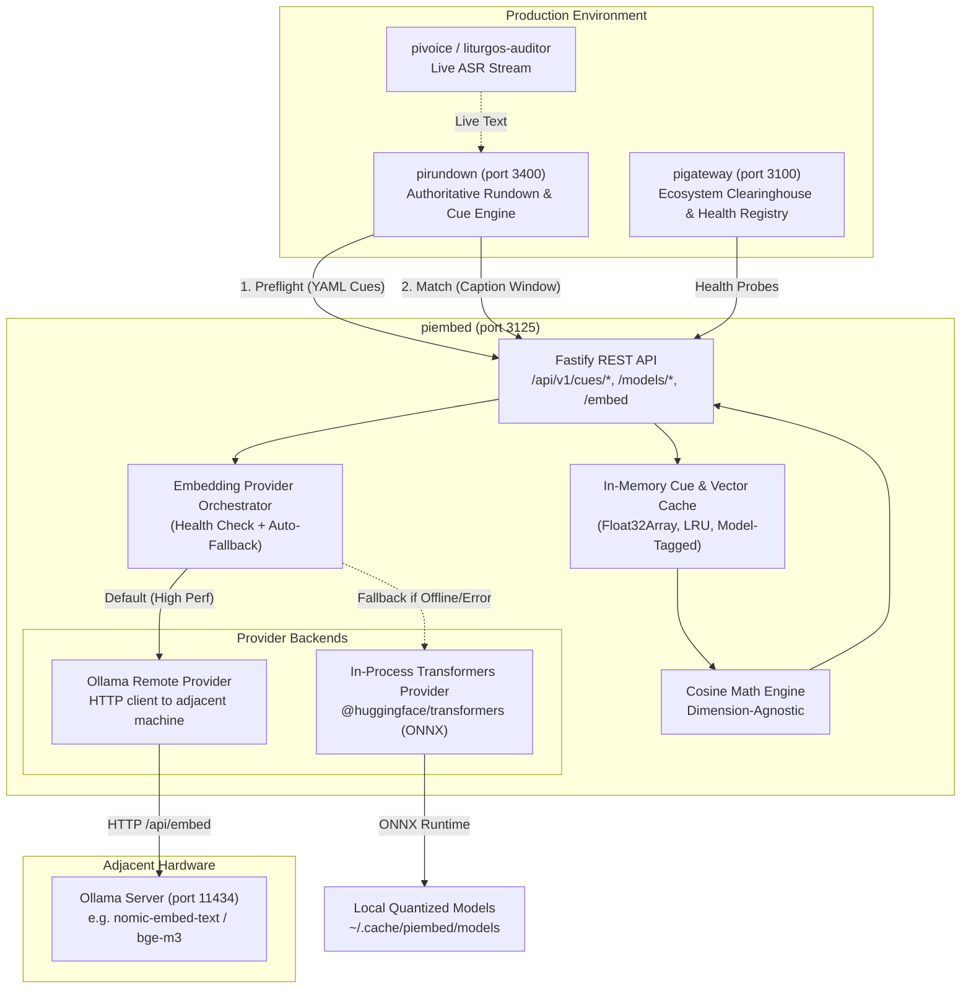

# Architecture & Implementation Plan: `piembed` Vector Microservice

## Executive Summary

`piembed` is a lightweight, dedicated microservice designed to provide high-performance text embeddings and vector similarity calculations for the **Raspberry Pi Production Ecosystem** (`piecosystem`).

Its primary role is powering **real-time semantic cue detection** for [`pirundown`](file:///D:/pirundown) during live broadcast liturgy and sermon tracking, while remaining completely decoupled from heavy agent chat loops.

---

## Key Requirements & Design Principles

1. **Remote Ollama by Default**: Default to querying an external/adjacent Ollama server (e.g. `http://192.168.x.x:11434` or configurable `OLLAMA_URL`) to offload embedding math to dedicated GPU/NPU hardware.
2. **Seamless In-Process Fallback**: If the remote Ollama server is unreachable, times out, or returns an error, automatically fall back to an in-process ONNX engine powered by `@huggingface/transformers` (`onnxruntime-node`).
3. **Dynamic Hugging Face Model Management**: Expose dedicated endpoints to inspect, load, and download Hugging Face models into the local in-process cache at runtime without restarting the service.
4. **Dimension-Agnostic Vector Engine**: Dynamically accommodate any vector dimensionality (384, 768, 1024, 1536) using normalized `Float32Array` representations and fast SIMD-friendly cosine similarity.
5. **Two-Stage Semantic Cue Protocol**:
   - **Preflight Phase**: [`pirundown`](file:///D:/pirundown) registers all semantic cue targets up-front at rundown load time (`POST /api/v1/cues/preflight`). Vectors are computed and held in memory.
   - **Runtime Live Matching Phase**: Live ASR speech windows are matched against active cue IDs in a single forward pass (`POST /api/v1/cues/match`).
6. **Ecosystem Compliance**: Standard REST API, Fastify + TypeScript runtime, port assignment (`3125`), unit tests, and registration in `pigateway` and `piecosystem`.

---

## System Architecture



---

## Detailed Component Specifications

### 1. Provider Orchestrator & Automatic Fallback

The orchestrator maintains an active health status of the primary provider (Ollama) and manages graceful failover:

```typescript
export interface EmbeddingResult {
  vectors: Float32Array[];
  provider: "ollama" | "inprocess";
  model: string;
  dimensions: number;
  durationMs: number;
}

export class EmbeddingOrchestrator {
  private primary: OllamaEmbeddingProvider;
  private fallback: InProcessTransformersProvider;
  private ollamaAvailable: boolean = false;
  private lastHealthCheck: number = 0;

  async embed(texts: string[], requestedModel?: string): Promise<EmbeddingResult> {
    if (this.isOllamaConfiguredAndHealthy()) {
      try {
        const start = Date.now();
        const res = await this.primary.embed(texts, requestedModel);
        return { ...res, provider: "ollama", durationMs: Date.now() - start };
      } catch (err) {
        logger.warn("[piembed] Remote Ollama call failed. Tripping circuit breaker to in-process fallback:", err.message);
        this.ollamaAvailable = false;
      }
    }

    // In-process fallback
    const start = Date.now();
    const res = await this.fallback.embed(texts, requestedModel);
    return { ...res, provider: "inprocess", durationMs: Date.now() - start };
  }
}
```

> [!NOTE]
> Ollama health checks run asynchronously in the background every 15–30 seconds. If an adjacent machine boots up or reconnects to the network, `piembed` seamlessly switches back to Ollama without service interruption.

---

### 2. In-Process Hugging Face Provider (`@huggingface/transformers`)

- **Dependencies**: `@huggingface/transformers` with `onnxruntime-node`.
- **Preconfigured Multilingual Default**: `Xenova/paraphrase-multilingual-MiniLM-L12-v2` (384 dimensions, ~118MB quantized `q8`, fast Finnish/English comprehension).
- **Model Storage**: Models are cached locally on disk in `~/.cache/piembed/models` (or `PIEMBED_MODEL_CACHE_DIR`).

```typescript
export class InProcessTransformersProvider {
  private pipeline: any = null;
  private currentModel: string = "Xenova/paraphrase-multilingual-MiniLM-L12-v2";

  async loadModel(modelId: string, options?: { quantized?: boolean }): Promise<{ model: string; dimensions: number }> {
    const { pipeline } = await import("@huggingface/transformers");
    this.pipeline = await pipeline("feature-extraction", modelId, {
      quantized: options?.quantized ?? true,
      cache_dir: process.env.PIEMBED_MODEL_CACHE_DIR,
    });
    this.currentModel = modelId;
    
    // Probe dimension with dummy input
    const probe = await this.pipeline("test", { pooling: "mean", normalize: true });
    return { model: modelId, dimensions: probe.data.length };
  }
}
```

---

### 3. API Specification

#### A. Semantic Cue Workflow (For `pirundown`)

1. **`POST /api/v1/cues/preflight`**
   - **Purpose**: Registers and pre-computes vector embeddings for rundown cue phrases up front.
   - **Body**:
     ```json
     {
       "rundownId": "liturgy-2026-11-01",
       "cues": [
         { "id": "cue_creed", "phrase": "Minä uskon Jumalaan, Isään Kaikkivaltiaaseen" },
         { "id": "cue_paternoster", "phrase": "Isä meidän, joka olet taivaissa" },
         { "id": "cue_benediction", "phrase": "Herra siunatkoon teitä ja varjelkoon teitä" }
       ]
     }
     ```
   - **Response**:
     ```json
     {
       "status": "ok",
       "provider": "ollama",
       "model": "bge-m3:latest",
       "dimensions": 1024,
       "registered": 3,
       "durationMs": 48
     }
     ```

2. **`POST /api/v1/cues/match`**
   - **Purpose**: Compares incoming live caption window text against specific active cue IDs.
   - **Body**:
     ```json
     {
       "text": "ja nyt me rukoilemme yhdessä Isä meidän joka olet taivaissa pyhitetty olkoon",
       "cueIds": ["cue_paternoster", "cue_benediction"],
       "threshold": 0.70
     }
     ```
   - **Response**:
     ```json
     {
       "matched": true,
       "bestMatch": {
         "id": "cue_paternoster",
         "score": 0.864,
         "threshold": 0.70
       },
       "results": [
         { "id": "cue_paternoster", "score": 0.864, "matched": true },
         { "id": "cue_benediction", "score": 0.312, "matched": false }
       ],
       "provider": "ollama",
       "latencyMs": 14
     }
     ```

3. **`DELETE /api/v1/cues/preflight/:rundownId`**
   - **Purpose**: Clears cached preflight cues when a rundown concludes or unloads.

---

#### B. Dynamic Hugging Face & Model Management

1. **`GET /api/v1/models`**
   - Returns loaded models, provider status, active model dimensions, and cached models on disk.
2. **`POST /api/v1/models/load`**
   - Loads a model into memory.
   - Body:
     ```json
     {
       "source": "huggingface", // or "ollama"
       "model": "intfloat/multilingual-e5-small",
       "quantized": true
     }
     ```
3. **`POST /api/v1/models/download`**
   - Downloads a model from Hugging Face into disk cache in advance without interrupting active live sessions.

---

#### C. General Vector Utility Endpoints

1. **`POST /api/v1/embed`**
   - General batch embedding generator: accepts `texts: string[]`, returns `vectors: number[][]`.
2. **`POST /api/v1/compare`**
   - Direct cosine similarity computation between a query text and candidate texts.

---

## Directory & File Structure (`D:\piembed`)

```
D:\piembed\
├── package.json
├── tsconfig.json
├── README.md
├── .env.example
├── src\
│   ├── main.ts                       # Server bootstrap & port listener
│   ├── app.ts                        # Fastify instance setup
│   ├── config.ts                     # Env parser (Ollama URL, ports, defaults)
│   ├── providers\
│   │   ├── types.ts                  # Provider interfaces & vector types
│   │   ├── orchestrator.ts           # Automatic fallback & health checking
│   │   ├── ollama-provider.ts        # Adjacent Ollama /api/embed client
│   │   └── transformers-provider.ts  # In-process Hugging Face ONNX pipeline
│   ├── vector\
│   │   ├── math.ts                   # Fast cosine similarity & L2 norm
│   │   ├── cue-store.ts              # In-memory preflight vector registry
│   │   └── lru-cache.ts              # LRU cache for text -> vector
│   ├── routes\
│   │   ├── cue-routes.ts             # /cues/preflight, /cues/match
│   │   ├── model-routes.ts           # /models/load, /models/download, /models
│   │   └── embed-routes.ts           # /embed, /compare
│   └── system\
│       ├── health.ts                 # Health & readiness checks
│       └── logger.ts                 # Structured ecosystem logging
└── tests\
    ├── math.test.ts                  # Vector math & dimension tests
    ├── orchestrator.test.ts          # Ollama-to-inprocess fallback tests
    ├── cue-matching.test.ts          # Preflight & matching workflow tests
    └── routes.test.ts                # Fastify HTTP integration tests
```

---

## Ecosystem Integration Steps

1. **`pirundown` (`D:\pirundown`)**:
   - Extend [`rundown-v2.ts`](file:///D:/pirundown/src/schema/rundown-v2.ts) with `SemanticCueSchema`:
     `{ type: "semantic", phrase: string, threshold?: number, context_mode?: "line" | "window" | "both" }`.
   - Update [`CueMatcher`](file:///D:/pirundown/src/cues/cue-matcher.ts) to evaluate `semantic` cues via `piembedUrl`.
   - Update [`RundownEngine`](file:///D:/pirundown/src/engine/rundown-engine.ts) to call `/api/v1/cues/preflight` on rundown load.
2. **`pigateway` (`D:\pigateway`)**:
   - Add `PIGATEWAY_PIEMBED_API_URL` to `config.ts` (default `http://127.0.0.1:3125`).
   - Register `piembed` in `ecosystem-tracker.ts` component health checks.
3. **`piecosystem` Registry**:
   - Register port `3125` in [`inter-service-matrix.md`](file:///D:/piecosystem/docs/inter-service-matrix.md).
   - Document `piembed` in [`projects-catalog.md`](file:///D:/piecosystem/docs/projects-catalog.md).
   - Add status probe to [`ecosystem-status.mjs`](file:///D:/piecosystem/scripts/ecosystem-status.mjs).

---

## Recommended Execution Stages

- [x] **Stage 1: Repository Scaffolding & Math Core**
  - Initialize `D:\piembed`, configure Fastify, TypeScript, and write SIMD/dimension-agnostic vector math (`Float32Array` cosine similarity).
- [x] **Stage 2: Remote Ollama & In-Process Transformers Providers**
  - Implement `OllamaEmbeddingProvider` targeting adjacent machine.
  - Implement `InProcessTransformersProvider` with `@huggingface/transformers`.
  - Implement `EmbeddingOrchestrator` with circuit breaker and automatic fallback.
- [x] **Stage 3: Cue Preflight & Matching Engine**
  - Implement in-memory `CueStore`.
  - Wire `/api/v1/cues/preflight` and `/api/v1/cues/match`.
  - Wire `/api/v1/models/load` and `/api/v1/models/download`.
- [x] **Stage 4: Unit & Integration Testing**
  - Test varying dimensions (384, 768, 1024).
  - Simulate remote Ollama timeout and verify 0-lag fallback to in-process.
- [x] **Stage 5: `pirundown` & `pigateway` Integration**
  - Wire preflight call in `pirundown/src/engine/rundown-engine.ts`.
  - Wire cue evaluation in `pirundown/src/cues/cue-matcher.ts`.
  - Update `pigateway` and `piecosystem` documentation.
