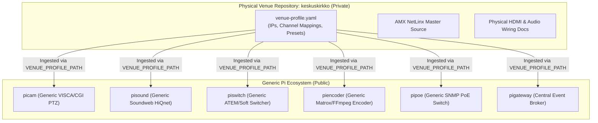

# Site Profile & Venue Configuration Specification

This specification formalizes the architectural boundary between the generic **Pi Production Ecosystem** (`piecosystem`) and site-specific physical venue deployments (primarily [`keskuskirkko`](file:///d:/keskuskirkko) for Riihimäen Keskuskirkko).

---

## 1. Architectural Boundary & Separation of Concerns

To ensure modularity and maintainability:
- **`piecosystem` and `pi*` microservices**: Contain zero church-specific hardcoded IP addresses, physical device identifiers, or sanctuary layouts. They implement generic drivers, protocol encoders/decoders (VISCA, HiQnet, ATEM, Tally-Ma, SNMP, Matrox HTTP SDK), and orchestration logic.
- **[`keskuskirkko`](file:///d:/keskuskirkko)**: The single authoritative repository for all physical location data, AMX NetLinx source code, hardware inventory, LAN IP allocations, BSS Soundweb DSP channel wiring, and sanctuary 3D coordinates.



---

## 2. Ingestion Mechanism

Microservices consume venue configuration through one of three standard methods:

1. **Environment Variable Path** (Recommended for local workstations and edge Pis):
   ```bash
   VENUE_PROFILE_PATH=/etc/pieco/venue-profile.yaml
   # Or on Windows workstations:
   VENUE_PROFILE_PATH=D:\keskuskirkko\venue-profile.yaml
   ```
2. **Environment Variable URL** (For containerized or remote workers):
   ```bash
   VENUE_PROFILE_URL=http://pigateway:3000/api/v1/venue/profile
   ```
3. **`pigateway` Ingestion**: `pigateway` loads the venue profile at boot and exposes it across the ecosystem via `GET /api/v1/venue/profile` and SSE change events.

---

## 3. Canonical `venue-profile.yaml` Schema

```yaml
schema: 1
venue:
  id: "keskuskirkko"
  name: "Riihimäen Keskuskirkko"
  timezone: "Europe/Helsinki"
  locale: "fi-FI"

network:
  subnet: "192.168.1.0/24"
  topology: "flat-ethernet"
  gateway: "192.168.1.1" # 4G/5G Cellular Router (NAT & DHCP)
  switch:
    model: "PLANET SGS-4210-16P2S"
    description: "Managed 16-Port Gigabit 802.3at PoE+ Switch with 2 SFP Ports"
    ip: "192.168.1.2"
    snmpPort: 161
    snmpCommunity: "public"
    poeBudgetWatts: 220
    poeStandard: "802.3af / 802.3at"
    ports:
      1: { device: "cam-1", name: "AVer PTZ330 Cam 1", poe: true, standard: "802.3at" }
      2: { device: "cam-2", name: "AVer PTZ330 Cam 2", poe: true, standard: "802.3at" }
      3: { device: "wifi-ap", name: "Ubiquiti UniFi AP (iPad)", poe: true, standard: "802.3af" }
      4: { device: "tally-master", name: "Tally-Ma Wireless Master", poe: true, standard: "802.3af" }
      5: { device: "amx-nx2200", name: "AMX NX-2200 Master", poe: false }
      6: { device: "amx-md702", name: "AMX MD-702 Touch Panel", poe: true, standard: "802.3af" }
      7: { device: "atem-sdi-extreme", name: "Blackmagic ATEM SDI Extreme", poe: false }
      8: { device: "bss-blu100", name: "BSS Soundweb London BLU-100", poe: false }
      9: { device: "bss-blubob2", name: "BSS BLU-BOB2 Expander", poe: false }
      10: { device: "bss-bludan", name: "BSS BLU-DAN (Dante Primary)", poe: false }
      11: { device: "ah-sq5", name: "Allen & Heath SQ-5 Dante", poe: false }
      12: { device: "atlona-matrix", name: "Atlona AT-UHD-PRO3-44M LAN", poe: false }
      13: { device: "matrox-monarch", name: "Matrox Monarch HDX Encoder", poe: false }
      14: { device: "rack-pc", name: "Church Workstation (Rack PC)", poe: false }
      15: { device: "pigateway", name: "Raspberry Pi Gateway (Edge)", poe: false }
      16: { device: "uplink-router", name: "Uplink to 4G/5G Cellular Router", poe: false }
      17: { name: "SFP G17", status: "spare", poe: false }
      18: { name: "SFP G18", status: "spare", poe: false }

devices:
  # Video Switcher (managed by piswitch)
  videoSwitcher:
    id: "atem-sdi-extreme"
    model: "Blackmagic ATEM SDI Extreme ISO"
    ip: "192.168.1.20"
    port: 9910
    inputs:
      1: { name: "KAM1", device: "cam-1", type: "sdi", role: "Alttari PTZ camera" }
      2: { name: "KAM2", device: "cam-2", type: "sdi", role: "Puhuja PTZ camera" }
      3: { name: "KAM3", device: "cam-3", type: "sdi", role: "Tripod camera (main area second view)" }
      4: { name: "Rack PC (Atlona)", source: "atlona-matrix-out-4", type: "hdmi", role: "Workstation media / slides routed through Atlona matrix" }
      5: { name: "Unused", status: "unused" }
      6: { name: "Unused", status: "unused" }
      7: { name: "Unused", status: "unused" }
      8: { name: "Unused", status: "unused" }

  # PTZ Cameras (managed by picam & pispace)
  cameras:
    - id: "cam-1"
      name: "Alttarikamera (Camera 1)"
      model: "AVer PTZ330"
      ip: "192.168.1.21"
      viscaPort: 52381
      httpPort: 80
      streaming:
        protocol: "rtmp-push"
        pushUrl: "rtmp://192.168.1.14:1935/live/cam1"
        rtspFallbackUri: "rtsp://192.168.1.21:554/live_st1"
    - id: "cam-2"
      name: "Puhujakamera (Camera 2)"
      model: "AVer PTZ330"
      mac: "00:18:1A:06:99:49"
      ip: "192.168.1.22"
      viscaPort: 52381
      httpPort: 80
      streaming:
        protocol: "rtmp-push"
        pushUrl: "rtmp://192.168.1.14:1935/live/cam2"
        rtspFallbackUri: "rtsp://192.168.1.22:554/live_st1"
    - id: "cam-3"
      name: "Jalustakamera / KAM3 (Tripod Camera)"
      model: "AVer PTZ330 (Tripod mount)"
      ip: "192.168.1.23"
      viscaPort: 52381
      httpPort: 80
      location: "Saarnatuolin puoleisen parven alla, etuseinässä"
      role: "Brought in on tripod for a second perspective on the main chancel/altar area"
      connection: "Plain SDI tie line straight into ATEM SDI Input 3"

  # HDMI & HDBaseT Video Matrix (managed by pimatrix & AMX)
  videoMatrix:
    model: "Atlona AT-UHD-PRO3-44M"
    description: "4K/UHD Dual-Distance 4x4 HDMI to HDBaseT Matrix Switcher with PoE & 5th HDMI mirror output"
    serialPort:
      amxDevice: "5001:1:0"
      baud: 115200
      commandSyntax: "x<input>AVx<output>\\r"
    inputs:
      1: { name: "Lukupulpetti (Lectern)", source: "Kramer TP-590Txr / TP-580Rxr" }
      2: { name: "Rack PC", source: "Workstation HDMI Out" }
      3: { name: "Pi HDMI 1 (hdmi0)", source: "pimatrix HDMI-A-1 (red)" }
      4: { name: "Pi HDMI 2 (hdmi1)", source: "pimatrix HDMI-A-2 (green)" }
    outputs:
      1: { name: "Sali Vasen (Left Projector)", sink: "Epson EB-L1050U", type: "hdbaset" }
      2: { name: "Sali Oikea (Right Projector)", sink: "Epson EB-L1050U", type: "hdbaset" }
      3: { name: "Kuoroparvi / Screen 3", sink: "Auxiliary Display", type: "hdbaset" }
      4: { name: "Video Mixer / ATEM Input 4", sink: "ATEM SDI Extreme ISO Input 4", type: "hdbaset" }
      5: { name: "HDMI Out (Mirror Output)", sink: "Video Mixer Feed", type: "hdmi", mirrorTarget: 4 }

  # Streaming & Archival Encoder (managed by piencoder)
  encoder:
    id: "matrox-monarch-hdx"
    model: "Matrox Monarch HDX (MHDX/I)"
    description: "Dual-channel H.264 broadcast streaming and recording appliance"
    ip: "192.168.1.13"
    httpPort: 80
    apiPath: "/Monarch/syncconnect/sdk.aspx"
    inputs:
      video: ["3G-SDI", "HDMI"]
      audio: ["ANALOG-AUX", "DIGITAL-EMBEDDED"]
    encoders:
      encoder1: { role: "Primary Broadcast Stream", protocols: ["RTMP", "RTSP"] }
      encoder2: { role: "Archival Recording or Secondary Stream", targets: ["USB", "SD", "SMB"] }
    ecosystemDriver:
      service: "piencoder"
      port: 3104

  # Audio DSP & Complete Sound System (managed by pisound & pivoice)
  audio:
    dsp:
      model: "BSS Soundweb London BLU-100"
      hiqnetNode: 1
      primaryIp: "192.168.1.31"
      secondaryIp: "192.168.1.42"
      port: 1023
    expansion:
      danteBridge: { model: "BSS BLU-DAN (BLU-DA)", hiqnetNode: 2 }
      inputExpanders:
        - { model: "BSS BLU-BIB #1", channels: 8, role: "Sanctuary wired speech microphones" }
        - { model: "BSS BLU-BIB #2", channels: 8, role: "Pulpit stage box inputs 1-8" }
        - { model: "BSS BLU-BIB #3", channels: 8, role: "Wireless microphone receiver inputs" }
      outputExpander: { model: "BSS BLU-BOB2 #4", ip: "192.168.1.30", channels: 8 }
      liveMixer: { model: "Allen & Heath SQ-5", connection: "Dante" }
      wirelessReceivers: { model: "3x JTS R-4 UHF Receivers", channels: 12 }
    channels:
      fixedMics:
        - { index: 1, name: "Alttari (Altar)", drop: "AV5" }
        - { index: 2, name: "Saarnatuoli / Saarna (Pulpit)", drop: "AV4" }
        - { index: 3, name: "Lukupulpetti / Luku (Lectern)", drop: "AV3" }
        - { index: 4, name: "Alttariseinä Vasen", drop: "AV1" }
        - { index: 5, name: "Alttariseinä Oikea", drop: "AV2" }
        - { index: 6, name: "Alttariseinä Keski" }
        - { index: 7, name: "Kanttori" }
        - { index: 8, name: "Tapuli (Bell Tower)" }
      stageDrops:
        description: "Liitännät saarnatuolin alla (1-8)"
        channels: [1, 2, 3, 4, 5, 6, 7, 8]
      wirelessMics:
        - { bank: 1, receiver: "JTS R-4 #1", channels: ["WL 1", "WL 2", "WL 3", "WL 4"] }
        - { bank: 2, receiver: "JTS R-4 #2", channels: ["WL 5", "WL 6", "WL 7", "WL 8"] }
        - { bank: 3, receiver: "JTS R-4 #3", channels: ["WL 9", "WL 10", "WL 11", "WL 12"] }
    outputZones:
      - { id: "sivulaivat", name: "Sali Sivulaivat", speakers: "JBL CBT50LA-1" }
      - { id: "parvi-alla", name: "Parven alla", speakers: "DAP EVO6T" }
      - { id: "urkuparvi", name: "Urkuparvi", speakers: "JBL Control 23-1" }
      - { id: "kanttori", name: "Kanttorimonitorit L/R", speakers: "DAP X1-5mkII" }
      - { id: "alttari-mon", name: "Alttarimonitori" }
      - { id: "subwoofer", name: "Subwoofer", model: "Fohhn DLI-130ANA" }
      - { id: "induktiosilmukka", name: "Induktiosilmukka", amplifier: "RDUCH WPI-1000" }
      - { id: "sakasti", name: "Sakasti Relay" }
      - { id: "kirkkoseimi", name: "Kirkkoseimi Relay" }
      - { id: "netti-radio", name: "Netti-radio / Stream Egress" }
```
