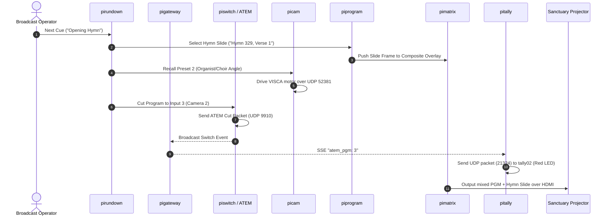
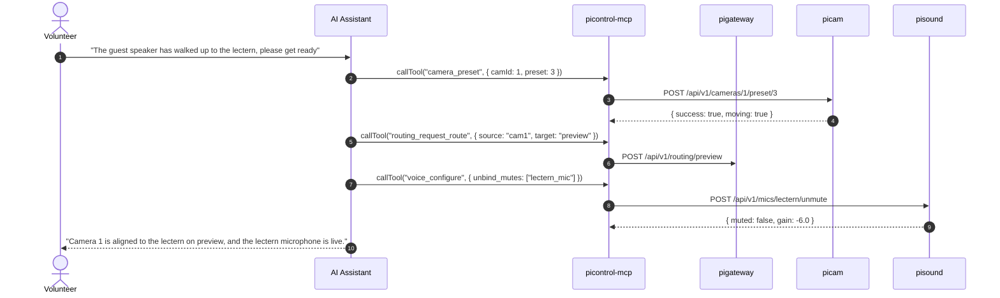
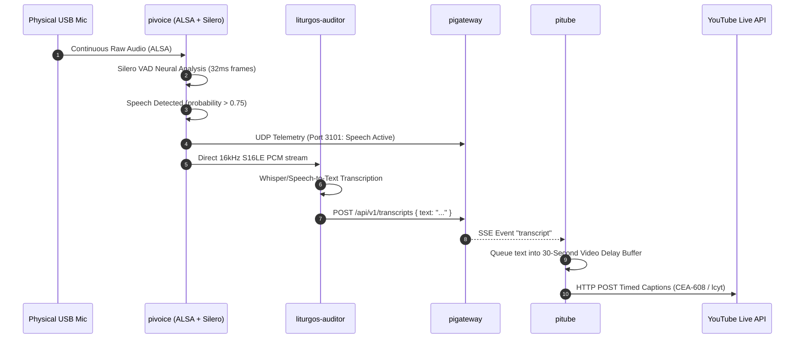

# End-to-End Workflow Scenarios

This document walks through real-world operational workflows across the Pi ecosystem layers to demonstrate how microservices collaborate in practice.

---

## Scenario A: Automated Sunday Service Cue Execution

When a service conductor or automation engine triggers the next cue in the liturgy:

1. **Trigger**: Operator presses "Next" in `picontrol` or `pirundown` CLI.
2. **Content Prep (Layer 2)**: `piprogram` renders the formatted hymn graphic and submits it to `pimatrix` overlay slot.
3. **Hardware Repositioning (Layer 1)**: `picam` sends VISCA UDP packets to reposition Camera 2 to preset 2.
4. **Switch Execution (Layer 1 & 2)**: `piswitch` triggers an ATEM cut to Camera 2.
5. **State Broadcast (Layer 3)**: `pigateway` detects the PGM change and broadcasts an SSE event.
6. **Tally Indication (Layer 1)**: `pitally` catches the event and sets the physical tally light on Camera 2 to RED.
7. **Egress (Layer 4)**: The live HDMI feed to the sanctuary projector and YouTube RTMP encoder switches seamlessly.

---

## Scenario B: AI Agent Live Assistance via MCP

An AI assistant (Claude, Gemini, Antigravity) running with `picontrol-mcp` tools assists a volunteer:

1. The volunteer gives a natural language command.
2. The agent queries resources (`pi://cameras`, `pi://routing/matrix`).
3. The agent dispatches tool calls to `picontrol-mcp` over Streamable HTTP on port `3200`.
4. `picontrol-mcp` validates RBAC permissions and routes requests to the relevant microservices.
5. Camera repositions, preview bus updates, and microphone audio level un-mutes automatically.

---

## Scenario C: Real-Time Audio Capture, VAD & YouTube Live Captions

Continuous automated speech detection and synchronized YouTube closed captioning:

1. **Hardware Capture (Layer 1)**: `pivoice` captures USB audio from the sanctuary pulpit/altar microphone.
2. **In-Process VAD (Layer 2)**: Embedded Silero ONNX VAD detects human speech vs background organ music.
3. **Transcription Pipeline (Layer 2/4)**: Clean 16kHz PCM audio flows into `liturgos-auditor`.
4. **State Distribution (Layer 3)**: Resulting text tokens are forwarded to `pigateway` SSE bus.
5. **Latency Alignment & Egress (Layer 4)**: `pitube` holds the text in a synchronized delay queue to match YouTube's 30-second live distribution buffer, streaming timed subtitles right when the minister speaks on screen.
